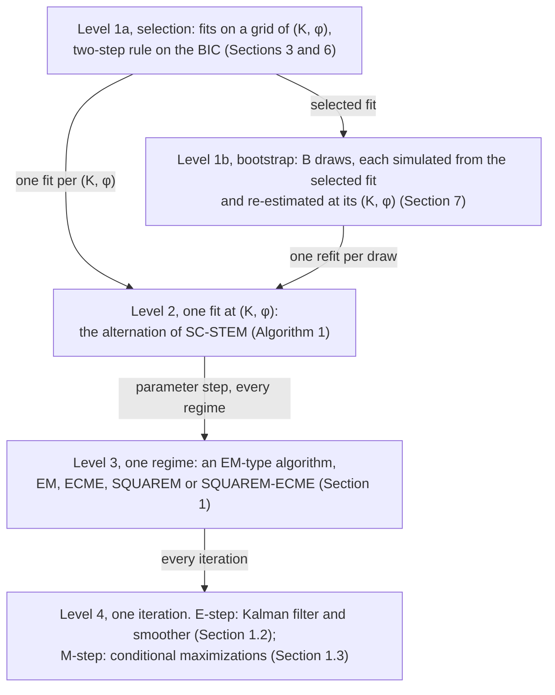
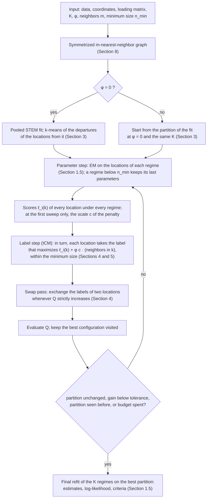
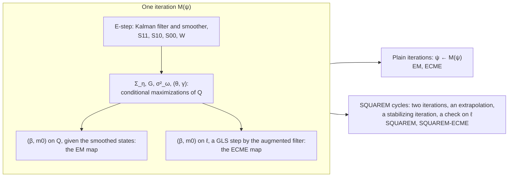
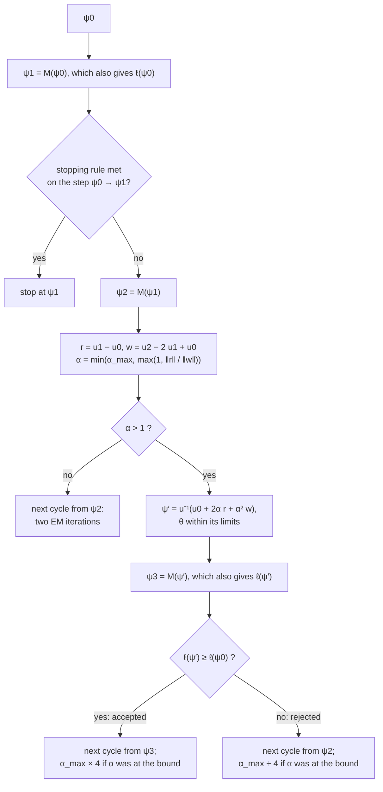
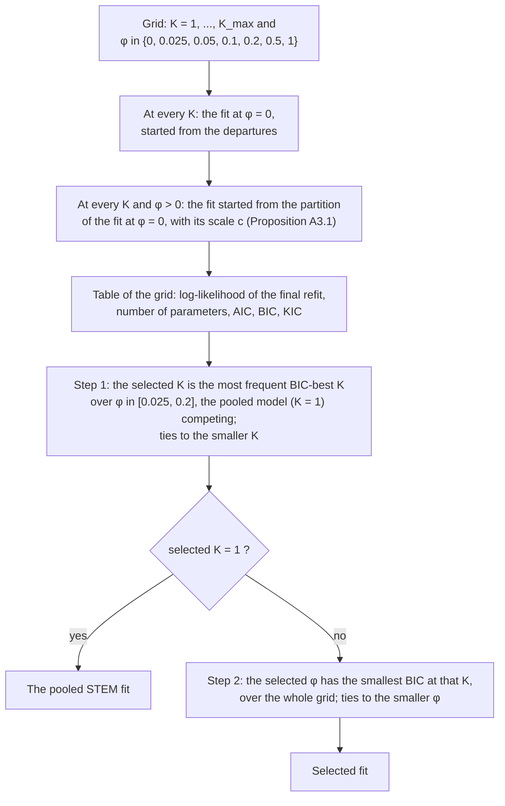
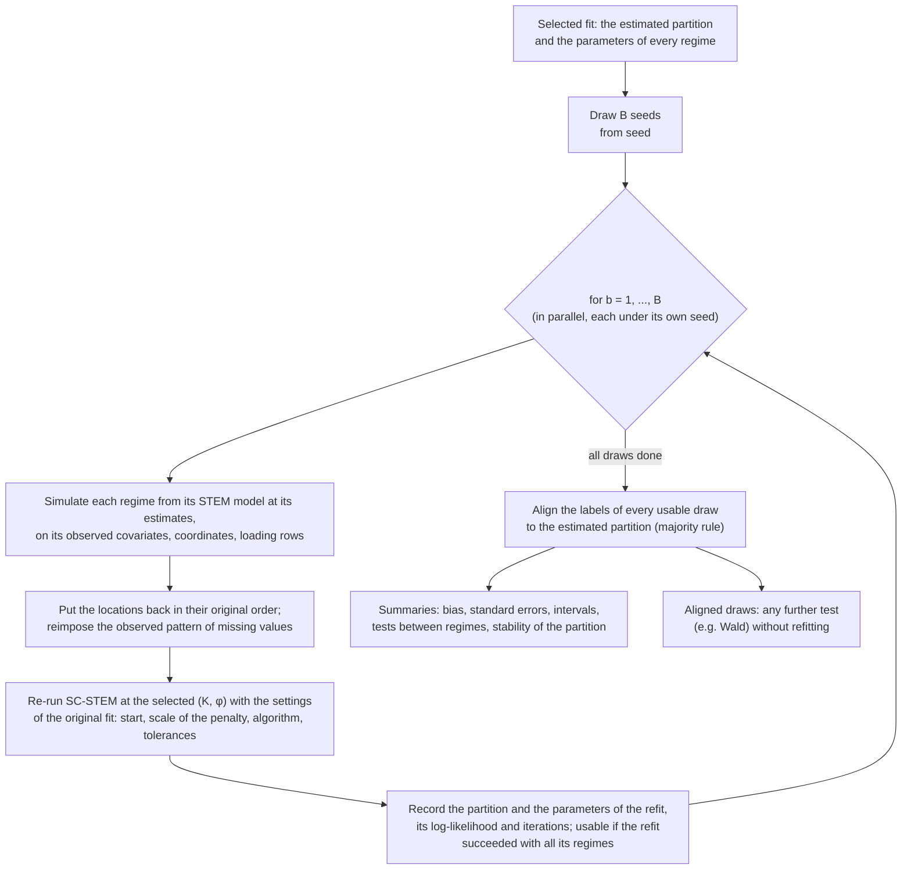

# Computational aspects of Stem

[Back to the README](../README.md) | [All pages](README.md)

How `Stem` estimates STEM and SC-STEM, and why it does what it does: the
state-space form, the Kalman filter and smoother every algorithm rests on, the
EM algorithm, its stopping rule and where it is slow, the two accelerations
(ECME and SQUAREM), the limits within which the range is estimated, the
treatment of missing responses, and, for SC-STEM, the start of a fit and the
scale of the Potts penalty, the control of degeneracy, the label update, the
information criteria, the refit-with-clustering bootstrap and the tests built
on it, and the use of the Potts penalty on point-referenced data.

This page follows the Computational and Algorithmic Supplement of the paper
(Supplement A), which ships with the package, section by section, and adds the
implementation details and the numerical evidence behind the defaults:

```r
browseURL(system.file("extdata", "Stem-computational-supplement.pdf", package = "Stem"))
```

The numerical experiments are documented in full in the vignette
`estimation-experiments` (`vignette("estimation-experiments", package = "Stem")`).
The optional penalty on the regression coefficients (ridge, lasso, elastic net)
has [a page of its own](regularization.md).

Contents

- [A map of the computations](#a-map-of-the-computations): the four nested levels of the computation, how often each runs and where each is explained, and Algorithm 1 of the paper as a flowchart

1. [Estimation: the Kalman filter, the EM algorithm and its accelerations](#1-estimation-the-kalman-filter-the-em-algorithm-and-its-accelerations) (Supplement A, Section A1)
2. [Missing observations](#2-missing-observations) (A2)
3. [Initialization and the scale of the penalty](#3-initialization-and-the-scale-of-the-penalty) (A3)
4. [Degeneracy, the minimum-size constraint and the swap pass](#4-degeneracy-the-minimum-size-constraint-and-the-swap-pass) (A4)
5. [The label update and the monotonicity of the alternation](#5-the-label-update-and-the-monotonicity-of-the-alternation) (A5)
6. [The information criteria as T and d grow](#6-the-information-criteria-as-t-and-d-grow) (A6)
7. [Inference under the refit-with-clustering bootstrap](#7-inference-under-the-refit-with-clustering-bootstrap) (A7)
8. [The Potts penalty on point-referenced data](#8-the-potts-penalty-on-point-referenced-data) (A8)
9. [What SC-STEM does and does not cover](#9-what-sc-stem-does-and-does-not-cover) (A9)
10. [No jitter in the inversions](#10-no-jitter-in-the-inversions)
11. [Numerical experiments](#11-numerical-experiments)
12. [Where it is in the code](#12-where-it-is-in-the-code)

---

## A map of the computations

Estimating SC-STEM and drawing inference on it is not one computation but
several, nested one inside the other: each calls the next many times. The
sections below treat them from the inside out, starting from the Kalman filter
in Section 1, whereas a user meets them from the outside in, starting from the
selection of the model. This map links the two orders. It can be skipped on a
first reading and consulted whenever a section refers to a level above or below
its own.

| level | what it computes | how often it runs | function | sections |
|---|---|---|---|---|
| 1a. Selection | the fits on a grid of $(K, \phi)$, and the choice of one of them by the two-step rule on the BIC | once per data set | `SCSTEM_Infocrit()`, `SCSTEM_Select()` | 3, 6 |
| 1b. Bootstrap | $B$ data sets simulated from the selected fit, each re-estimated at its $(K, \phi)$, and the inference drawn from them | once, after the selection | `SCSTEM_Bootstrap()`, `SCSTEM_BootInference()` | 7 |
| 2. One fit at $(K, \phi)$ | the partition and the parameters of the regimes, by the alternation of SC-STEM (Algorithm 1 of the paper) | once per configuration of the grid and per draw of the bootstrap | `SCSTEM_Estimation()` | 3, 4, 5, 8 |
| 3. One regime | the parameters of one regime given its locations, by an EM-type algorithm: EM, ECME, SQUAREM or SQUAREM-ECME | at every parameter step of the alternation, for every regime | `STEM_Estimation()` | 1, 2 |
| 4. One iteration | the E-step (the Kalman filter and smoother) and the M-step | at every iteration of the algorithm | internal: `stem_estep()`, `stem_mstep_em()`, `stem_mstep_ecme()` | 1.2, 1.3 |

In the diagram, each box is one of these computations, an arrow goes from a
computation to the one it calls, and its label says how often. The cost
multiplies along the arrows: every configuration of the grid runs several
sweeps of the alternation, every sweep runs an EM-type algorithm on every
regime, and every iteration of that algorithm runs the Kalman filter and
smoother, so that one selection runs the filter thousands of times. This is why
the speed of the two innermost levels (Sections 1.6 to 1.9) matters for the
whole procedure.



**Level 2 in detail: Algorithm 1 of the paper.** The second level is the core
of SC-STEM. The flowchart follows one fit at fixed $K$ and $\phi$ as
`SCSTEM_Estimation()` runs it, and each box names the section that explains
it. After a start, the fit alternates a parameter step, which estimates every
regime given the partition (level 3), and a label step, which reassigns the
locations given the parameters, until the partition settles; it then refits the
regimes on the best partition it has visited.



---

## 1. Estimation: the Kalman filter, the EM algorithm and its accelerations

### 1.1 The model in state-space form

Within a regime, or in the pooled fit, STEM is the state-space model

```math
z_t = X_t \beta + A\, y_t + e_t, \qquad e_t \sim N(0, \Sigma_e), \qquad \Sigma_e = \sigma^2_\omega C_\theta + \sigma^2_\epsilon I_d,
```

```math
y_t = G\, y_{t-1} + \eta_t, \qquad \eta_t \sim N(0, \Sigma_\eta), \qquad y_0 \sim N(m_0, C_0),
```

for $t = 1, \dots, T$, with $z_t$ the $d$ observations at time $t$, $A$ the
$d \times p$ loading matrix and $C_0$ known; in the paper $p = 1$ and
$A = \mathbf{1}_d$. The package writes $\Sigma_e = \sigma^2_\omega \Gamma$ with
$\Gamma = C_\theta + \gamma I_d$ and $\gamma = \sigma^2_\epsilon / \sigma^2_\omega$,
and estimates
$\psi = (\beta, \sigma^2_\omega, \log\gamma, \log\theta, G, \Sigma_\eta, m_0)$
by the EM algorithm of Shumway and Stoffer (1982): the E-step is the Kalman
smoother, the M-step updates $G$, $\Sigma_\eta$, $m_0$, $\sigma^2_\omega$ and
$\beta$ in closed form and $(\log\theta, \log\gamma)$ by Newton-Raphson. The
log-likelihood $\ell(\psi)$ is the by-product of the Kalman filter (the
prediction-error decomposition).

### 1.2 The Kalman filter and smoother

Every algorithm of the package rests on three recursions, run at given
parameters by the internal function `kalman()`.

**The filter.** From $y_{0|0} = m_0$, $P_{0|0} = C_0$, for $t = 1, \dots, T$:

```math
y_{t|t-1} = G y_{t-1|t-1}, \quad P_{t|t-1} = G P_{t-1|t-1} G^\top + \Sigma_\eta, \quad
v_t = z_t - X_t \beta - A y_{t|t-1}, \quad F_t = A P_{t|t-1} A^\top + \Sigma_e,
```

```math
K_t = P_{t|t-1} A^\top F_t^{-1}, \quad y_{t|t} = y_{t|t-1} + K_t v_t, \quad P_{t|t} = P_{t|t-1} - K_t A P_{t|t-1},
```

```math
\ell(\psi) = -\tfrac12 \sum_{t=1}^T \left\{ d \log(2\pi) + \log|F_t| + v_t^\top F_t^{-1} v_t \right\}.
```

**The smoother.** With $J_t = P_{t|t} G^\top P_{t+1|t}^{-1}$, for
$t = T-1, \dots, 0$:

```math
y_{t|T} = y_{t|t} + J_t (y_{t+1|T} - y_{t+1|t}), \qquad P_{t|T} = P_{t|t} + J_t (P_{t+1|T} - P_{t+1|t}) J_t^\top .
```

**The lag-one covariance smoother** (Shumway and Stoffer 1982):

```math
P_{T,T-1|T} = (I - K_T A) G P_{T-1|T-1}, \qquad
P_{t-1,t-2|T} = P_{t-1|t-1} J_{t-2}^\top + J_{t-1} (P_{t,t-1|T} - G P_{t-1|t-1}) J_{t-2}^\top .
```

**The filter never inverts a $d \times d$ matrix.** $\Sigma_e$ does not depend on
$t$ and $A P_{t|t-1} A^\top$ has rank $p$, so the Woodbury identity and the
matrix determinant lemma reduce every step to $p \times p$ algebra against a
Cholesky factor of $\Sigma_e$ computed once per pass. A pass costs
$O(d^3 + T d^2 p)$ instead of $O(T d^3)$, and the log-density is evaluated in
closed form rather than as the logarithm of a density, which on a few hundred
locations underflows to `-Inf`. On a network of 200 stations over 365 days one
EM iteration is about ten times faster than the direct form, and a network of
400 stations, which the direct form cannot fit at all, takes about a second per
iteration. The two forms are algebraic identities of each other and agree to
about $10^{-13}$ in relative terms. Missing responses are handled by dropping
the unobserved rows of the measurement equation (Section 2); the vignette
`computational-notes` gives the details of the computation.

### 1.3 The EM algorithm

**E-step.** The expected complete-data log-likelihood depends on the states
only through the smoothed initial state and

```math
S_{11} = \sum_t (y_{t|T} y_{t|T}^\top + P_{t|T}), \quad
S_{00} = \sum_t (y_{t-1|T} y_{t-1|T}^\top + P_{t-1|T}), \quad
S_{10} = \sum_t (y_{t|T} y_{t-1|T}^\top + P_{t,t-1|T}),
```

```math
W = \sum_t (A P_{t|T} A^\top + r_t r_t^\top), \qquad r_t = z_t - X_t \beta - A y_{t|T},
```

completed by their conditional expectations where responses are missing
(Section 2).

**M-step.** The parameters are updated in turn, each given the updates that
precede it: $m_0 \leftarrow y_{0|T}$; $\Sigma_\eta$ and $G$ from $S_{11}$,
$S_{10}$, $S_{00}$ (element by element when diagonal, the default; otherwise
$\Sigma_\eta \leftarrow T^{-1}(S_{11} - S_{10} S_{00}^{-1} S_{10}^\top)$ and
$G \leftarrow S_{10} S_{00}^{-1}$);
$\sigma^2_\omega \leftarrow \mathrm{tr}(\Gamma^{-1} W)/(dT)$; $\beta$ by
generalized least squares given the smoothed states,

```math
\beta \leftarrow \Big(\sum_t X_t^\top \Sigma_e^{-1} X_t\Big)^{-1} \sum_t X_t^\top \Sigma_e^{-1} (\hat z_t - A y_{t|T}),
```

and $(\log\theta, \log\gamma)$ by a safeguarded Newton-Raphson step on

```math
Q_e(\theta, \gamma) = T \log|\sigma^2_\omega \Gamma| + \mathrm{tr}\{(\sigma^2_\omega \Gamma)^{-1} W\},
```

minus twice the part of $Q$ that depends on them (Section 1.10); finally
$\sigma^2_\epsilon = \gamma\, \sigma^2_\omega$. $W$ is computed once per
iteration, at the current $\beta$, so the updates are conditional
maximizations of $Q$, each in its own block at the current values of the
others. None of them decreases $Q$, so the algorithm is a generalized EM
algorithm and $\ell$ does not decrease along the iterations.

### 1.4 Stopping rule

The EM algorithm and the accelerated algorithms below stop by the same rule.
Two criteria are computed at every iteration (at every cycle under SQUAREM):
the largest relative change of a free parameter, taken one at a time,

```math
\max_l \frac{|\psi^{(j+1)}_l - \psi^{(j)}_l|}{\max(|\psi^{(j)}_l|, 10^{-3})},
```

on the scale on which the algorithm updates it and with the loading matrix and
$C_0$ excluded, and the absolute change of the log-likelihood,
$|\ell(\psi^{(j+1)}) - \ell(\psi^{(j)})|$. The algorithm stops as soon as
either falls below its tolerance (`em_stop = "any"`), or after a maximum number
of iterations:

| fit | parameters | log-likelihood | iterations | settings of `STEM_control()` |
|---|---|---|---|---|
| pooled fit, final refits of SC-STEM | $10^{-3}$ | $10^{-3}$ | 500 | `em_tol_par`, `em_tol_loglik`, `em_maxit` |
| fits inside the alternation of SC-STEM | $10^{-2}$ | $1$ | 50 | `alt_em_tol_par`, `alt_em_tol_loglik`, `alt_em_maxit` |

The criterion on $\ell$ is absolute because the differences that matter,
between fits and in the information criteria, are absolute, whereas a relative
criterion loosens as the log-likelihood grows with the size of the data.
Tolerances of $10^{-3}$ on both criteria left the estimates within 1 to 2% of
those at $10^{-4}$ and the selected models unchanged in the simulation study,
while $10^{-2}$ moved the range and the variances by tens of percent.

### 1.5 The EM algorithm within SC-STEM

SC-STEM fits one STEM model per regime, on the locations of the regime with the
rows $A_k$ of the loading matrix and the parameters $\psi_k$, and alternates
between the parameters and the labels (Algorithm 1 of the paper). The EM
algorithm enters in two places.

- **In the parameter step of the alternation**, where it only has to rank the
  regimes for the label step: a few plain EM (or ECME) iterations per regime,
  with the tolerances of the second row above, without acceleration. The first
  time, a regime starts from the least-squares coefficients of its own
  locations (an unpenalized fit) or from the final refit of the unpenalized
  solution the fit starts from (a penalized one, Section 3); every later time,
  from its own estimates of the previous iteration. The label step scores each
  location with the smoothed states and the measurement parameters of each
  regime.
- **In the final refit**, where the regimes are re-estimated once on the final
  partition, with the settings of the pooled fit and the algorithm chosen,
  starting from the estimates of the last iteration of the alternation. The
  reported estimates and log-likelihoods come from this refit. Fits of a grid
  that end at the same partition share one refit.

### 1.6 Where the EM algorithm is slow

**The rate of convergence.** An iteration maps the current parameters into new
ones, $\psi^{(j+1)} = M(\psi^{(j)})$, and the maximum $\hat\psi$ is the point
the map leaves unchanged. Near it the map is approximately linear,

```math
\psi^{(j+1)} - \hat\psi \approx J (\psi^{(j)} - \hat\psi), \qquad J = I_c^{-1} I_m ,
```

with $I_c$ the complete-data information and $I_m = I_c - I_o$ the information
missing because the states are not observed (Dempster, Laird and Rubin 1977;
Meng and Rubin 1994). The eigenvalues of $J$ lie in $[0, 1)$; the largest,
$\lambda$, is the rate of convergence: along its direction every iteration
removes only the fraction $1 - \lambda$ of the distance left, and reducing it
by a factor $\varepsilon$ takes about $\log\varepsilon/\log\lambda$ iterations.

**What a slow direction does to the stopping rule.** Along a direction with
rate $\lambda$ the change of one iteration is only a fraction of the distance
still to go:

```math
\|\psi^{(j)} - \hat\psi\| \approx \frac{\|\psi^{(j+1)} - \psi^{(j)}\|}{1-\lambda}, \qquad
\ell(\hat\psi) - \ell(\psi^{(j)}) \approx \frac{\ell(\psi^{(j+1)}) - \ell(\psi^{(j)})}{1-\lambda^2}.
```

These are not further rules but the error each criterion leaves when it stops:
a tolerance $\tau$ on the parameters leaves a relative error of about
$\tau/(1-\lambda)$, one on the log-likelihood a shortfall of about the
tolerance divided by $1-\lambda^2$. Where $\lambda$ is close to one the
iterations stop farther from the maximum, which is why removing the slow
directions makes the fits both faster and closer to the maximum at the same
tolerance.

On the regimes of SC-STEM four situations make $\lambda$ close to one or the
objective flat:

1. **The split of the common variation between the latent process and the
   field.** The latent process is common to the locations of a regime; the
   field, with a range comparable to the size of the regime, is nearly so at
   every time. Only their dynamics tell them apart, the latent process being
   persistent and the field white in time. The direction along which
   $(\sigma^2_\omega, \sigma^2_\epsilon, \theta, \Sigma_\eta)$ move together is
   slow, and it sets the number of iterations.
2. **The intercept and the initial level of the latent process.** The mean of
   the data is $X_t\beta + A G^t m_0$: a change of $m_0$ moves the first
   periods, which the intercept and the smoothed states partly absorb, and the
   EM algorithm corrects only a small part of the error at every iteration.
   This direction is the slowest but carries little likelihood: it is where the
   error at the stop sits. When $G$ is close to zero, $m_0$ enters only through
   $G m_0$, and $G$ and $m_0$ trade along a ridge of the likelihood.
3. **The range at the boundary of what the distances identify** (Section 1.10).
4. **A maximum on the boundary of the parameter space.** When the data do not
   support a latent process, as when a pooled model is fitted to regimes whose
   latent processes differ, the maximum lies at $\Sigma_\eta = 0$. Near a
   boundary every EM-type algorithm converges sublinearly, and on the
   logarithmic scale on which the accelerations extrapolate the boundary is
   never reached: the iterations stop close to it, with a large relative error
   on $\Sigma_\eta$ and a small absolute one.

### 1.7 The four algorithms at a glance

The four algorithms maximize the same likelihood and share the E-step, the
Kalman filter and smoother, which in a linear Gaussian state-space model is
exact posterior inference on the latent states. They differ in what the M-step
maximizes and in how successive iterations are combined. In the language of
machine learning, EM is coordinate ascent on the evidence lower bound, made
tight by the E-step; ECME replaces some of the coordinate updates by
"collapsed" ones, with the states integrated out; SQUAREM is an extrapolation of
the fixed-point map, in the family of Aitken's and Anderson's accelerations,
with a monotonicity safeguard (Section 1.9 builds it step by step).

**What the four share and where they differ.** $M$ is one iteration, an
E-step followed by an M-step.

| | EM | ECME | SQUAREM | SQUAREM-ECME |
|---|---|---|---|---|
| `STEM_control(algorithm = )` | `"EM"` | `"ECME"` | `"SQUAREM"` (default) | `"SQUAREM-ECME"` |
| E-step | Kalman filter and smoother | same | same | same |
| update of $\Sigma_\eta$, $G$, $\sigma^2_\omega$, $(\theta, \gamma)$ | conditional maximizations of $Q$; safeguarded Newton-Raphson within the limits of Section 1.10 for $(\theta, \gamma)$ | same | same | same |
| update of $(\beta, m_0)$ | maximizes $Q$ given the smoothed states | maximizes $\ell$: a GLS step by the augmented Kalman filter | as EM | as ECME |
| one iteration $M$ | the EM map | the ECME map | the EM map | the ECME map |
| how the iterations are combined | each starts from the last, $\psi^{(j+1)} = M(\psi^{(j)})$ | as EM | cycles: two iterations, an extrapolation, a stabilizing iteration | as SQUAREM, on the ECME map |
| cost of one $M$ | one filter and smoother pass | one more filter pass (about +25%) | as EM | as ECME |
| calls of $M$ per cycle | 1 | 1 | 3 (2 when $\alpha = 1$) | 3 (2 when $\alpha = 1$) |
| monotone because | no block decreases $Q$ (generalized EM) | the steps on $\ell$ follow those on $Q$ | an extrapolation that lowers $\ell$ is rejected | as SQUAREM |
| slow directions removed (Section 1.6) | none | intercept and $m_0$, and the ridge between $G$ and $m_0$ | the slowest one, in practice the split of the variance | both |
| not cured | boundary maximum; $G$-$m_0$ ridge | boundary maximum | boundary maximum; $G$-$m_0$ ridge | boundary maximum |
| inside the alternation of SC-STEM | EM | ECME | EM, not accelerated | ECME, not accelerated |
| limit | the maximum | the same maximum | the same maximum | the same maximum |

**One picture of the four.** One iteration $M$ is the same E-step and the same
updates of the variance and dynamic parameters in all four; EM and ECME differ
in the update of $(\beta, m_0)$; the plain and the SQUAREM variants differ in
how successive iterations are combined.



**What they cost and how close they stop.**

| `STEM_control(algorithm = )` | M-step | iterations combined | time | iterations | shortfall |
|---|---|---|---|---|---|
| `"EM"` | conditional maximizations of $Q$ | plain | 1 | 1 | 0.020 |
| `"ECME"` | as EM, with $(\beta, m_0)$ on $\ell$ | plain | 1.17 | 0.96 | 0.017 |
| **`"SQUAREM"`** (default) | as EM | two, extrapolated | **0.53** | 0.41 | 0.0027 |
| `"SQUAREM-ECME"` | as ECME | two, extrapolated | 0.62 | 0.39 | 0.0023 |

Time and iterations relative to EM on whole SC-STEM grids (six cells of the
simulation study, two replications each); shortfall: median shortfall of the
log-likelihood at the stop on single fits. All at the default tolerances; all
four are monotone, the accelerated ones through a safeguard on the
extrapolation.

The four converge to the same maximum, so the choice changes the cost and the
error left at a given tolerance, not the estimator. ECME buys accuracy rather
than speed: it removes the error left on the intercepts and on $m_0$, and on
$G$ when $G$ is near zero, but not the slow split of the variance, which sets
the number of iterations. SQUAREM buys speed, and with it accuracy at a given
tolerance; on the ECME map it combines the two. No algorithm cures a maximum on
the boundary of the parameter space, and only ECME addresses the ridge between
$G$ and $m_0$. SQUAREM is the default: it took about a third of the time of EM
on single fits and about half on whole SC-STEM grids, stopped closer to the
maximum, and selected the same models.

### 1.8 ECME

ECME, "expectation / conditional maximization either" (Liu and Rubin 1994),
keeps the E-step of EM and almost all of its M-step: it changes **one block of
the M-step**, the update of the regression coefficients and of the initial level
of the latent process, $\delta = (\beta^\top, m_0^\top)^\top$, which it takes
on the observed log-likelihood $\ell$ instead of on the expected complete-data
log-likelihood $Q$. Five steps build it.

**Step 1: why EM is slow on $\delta$.** EM updates $\beta$ and $m_0$ given the
smoothed states $y_{t|T}$ (Section 1.3). Suppose the current intercept is too
low by some amount. The E-step attributes most of that error to the latent
process, whose smoothed path moves up to absorb it; the M-step then updates
$\beta$ and $m_0$ given that path, and corrects only the small part of the
error that the path did not absorb. Each iteration removes a small fraction of
the error: this is the second slow direction of Section 1.6, with a rate close
to one. The cause is that $Q$ looks at $\delta$ through the states, and the
states and $\delta$ explain the same level of the data.

**Step 2: on the observed likelihood the problem is a regression.** Given all
the other parameters, $\ell$ depends on $\delta$ only through the mean of the
data,

```math
E(z_t) = X_t \beta + A G^t m_0 ,
```

which is linear in $\delta$, while the covariance of the data does not depend
on $\delta$ at all. So $\ell$, as a function of $\delta$, is the log-likelihood
of a Gaussian linear regression with a known covariance (the one the model
implies, latent process and spatial field included): it is a quadratic in
$\delta$, and its maximizer is the generalized least-squares (GLS) estimator.
Integrating the states out is what removes the trade between the states and the
level: the GLS step finds the right level at once.

**Step 3: GLS without the $dT \times dT$ covariance.** The covariance of all the
data is $dT \times dT$ and cannot be formed on a real network. The augmented
Kalman filter (de Jong 1991; Durbin and Koopman 2012, Ch. 6) computes the same
estimator from the filter. Two facts make it work: the gains $K_t$ and the
innovation covariances $F_t$ do not depend on the data, and the filter is
linear in its data and in its initial mean. Run the filter of the current
parameters on every column of the $d \times (1 + r + p)$ matrix

```math
\bigl[\, z_t,\ X_t,\ A G^t \,\bigr],
```

the first column with the current $m_0$ as initial mean and the others with
zero (the last block stands for a change $\Delta m_0$ of $m_0$). All columns
share $K_t$ and $F_t$; call $[\,e_t,\ E_t\,]$ their innovations. By linearity
the innovations of $z_t$ at $(\beta, m_0 + \Delta m_0)$ are $e_t - E_t\delta$
with $\delta = (\beta^\top, \Delta m_0^\top)^\top$, and by the prediction-error
decomposition

```math
\ell(\delta) = c - \tfrac12 \sum_t (e_t - E_t \delta)^\top F_t^{-1} (e_t - E_t \delta) .
```

**Step 4: the update.** Setting the gradient to zero gives the GLS normal
equations,

```math
\hat\delta = M^{-1} v, \qquad M = \sum_t E_t^\top F_t^{-1} E_t, \qquad v = \sum_t E_t^\top F_t^{-1} e_t ,
```

with $F_t^{-1}$ applied through the Woodbury identity (Section 1.2) and the
missing rows dropped (Section 2). Then $m_0 \leftarrow m_0 + \Delta m_0$.
Without a latent process there is no $m_0$ column. With a penalty on $\beta$,
$m_0$ is profiled out of the quadratic and the penalized update of
[the page on the penalty](regularization.md) is applied to what is left in
$\beta$ (`stem_update_mean_observed()` in `R/mstep-ecme.R`).

**Step 5: the order keeps it monotone.** Within an iteration the updates of
$\Sigma_\eta$, $G$, $\sigma^2_\omega$ and $(\theta, \gamma)$ on $Q$ come
first, exactly as in EM, and the update of $\delta$ on $\ell$ comes last. The
steps on $Q$ do not decrease $\ell$ (the EM argument), and the last step
maximizes $\ell$ over $\delta$ given the rest, so it does not decrease it
either: the algorithm is monotone (Liu and Rubin 1994). Had the step on $\ell$
come before steps on $Q$, the E-step would have to be recomputed in between, as
in the AECM algorithm of Meng and van Dyk (1997).

**One iteration, line by line** (`stem_mstep_ecme()` in `R/mstep-ecme.R`). The
lines marked ★ are those that differ from an iteration of EM.

```text
  E-step: Kalman filter and smoother at psi          # as EM: S11, S10, S00, W
  update Sigma_eta and G from S11, S10, S00          # as EM
  update sigma2_omega from W                         # as EM
  update (theta, gamma): safeguarded Newton-Raphson  # as EM (limits of Section 1.10)
★ run the filter at the new parameters on [z_t, X_t, A G^t]  -> innovations e_t, E_t, and F_t
★ M <- sum_t E_t' F_t^-1 E_t ;  v <- sum_t E_t' F_t^-1 e_t
★ (beta, Delta m0) <- M^-1 v ;  m0 <- m0 + Delta m0  # maximizes the observed loglik over (beta, m0)
                                                     # EM instead: m0 <- y_{0|T}; beta <- GLS given y_{t|T}
```

**What it buys and what it costs.** The step removes the second slow
direction of Section 1.6 at once, and with it the ridge between $G$ and $m_0$
(when $G$ is near zero, $m_0$ enters only through $G m_0$); it does not change
the first slow direction, the split of the variance, which sets the number of
iterations. An ECME iteration costs one more filter pass than an EM iteration,
about 25% more time. ECME therefore buys accuracy rather than speed: at the
same tolerance it stops closer to the maximum on the intercepts, on $m_0$ and on
$G$ near zero (Section 1.7).

### 1.9 SQUAREM

SQUAREM (Roland and Varadhan 2005; Varadhan and Roland 2008) does **not**
change the E-step or the M-step: it changes only how successive EM iterations
are combined. Write $M$ for one whole EM iteration, the E-step followed by the
M-step, so that the EM algorithm is the repeated application
$\psi^{(j+1)} = M(\psi^{(j)})$ and its maximum $\hat\psi$ is a fixed point,
$M(\hat\psi) = \hat\psi$. SQUAREM uses the same map $M$ (an EM iteration, or an
ECME iteration for SQUAREM-ECME), but instead of taking the last iterate as the
next starting point it combines the last iterates into a point farther along
the path the iterations follow. Six steps build it.

**Step 1: the error of EM shrinks geometrically.** Near the maximum the error
$e_j = \psi^{(j)} - \hat\psi$ obeys $e_{j+1} \approx J e_j$ (Section 1.6).
Along one direction with rate $\lambda$, $e_j = \lambda^j e_0$: every iteration
removes the same fraction $1 - \lambda$ of the error that is left. Reducing the
error by a factor $\varepsilon$ takes $\log\varepsilon/\log\lambda$
iterations:

| $\lambda$ | iterations to divide the error by 10 | by 1000 |
|---|---|---|
| 0.5 | 4 | 10 |
| 0.9 | 22 | 66 |
| 0.95 | 45 | 135 |
| 0.99 | 230 | 688 |

This is the cost SQUAREM attacks: on the regimes of SC-STEM the slow
directions of Section 1.6 have $\lambda$ close to one.

**Step 2: three successive iterates reveal the rate and the limit.** Start from
the current point $\psi_0$ and run two plain iterations,
$\psi_1 = M(\psi_0)$ and $\psi_2 = M(\psi_1)$, as EM would. Their first and
second differences are observable, and along a direction with rate $\lambda$

```math
r = \psi_1 - \psi_0 = (\lambda - 1)\, e_0, \qquad
w = \psi_2 - 2\psi_1 + \psi_0 = (\lambda - 1)^2\, e_0 .
```

$r$ is the EM step; $w$ says how the step shrinks from one iteration to the
next. Their ratio gives the unknown rate, $\|r\|/\|w\| = 1/(1-\lambda)$, and in
one dimension $e_0 = r^2/w$, so the limit is $\hat\psi = \psi_0 - r^2/w$: this
is Aitken's $\Delta^2$ extrapolation. EM computes $\psi_1$ and $\psi_2$ anyway;
SQUAREM uses them to estimate where the sequence is going instead of following
it one step at a time.

*A numerical example.* Take $\lambda = 0.9$, $\hat\psi = 0$ and $\psi_0 = 1$.
EM gives $\psi_1 = 0.9$ and $\psi_2 = 0.81$, so $r = -0.1$ and $w = 0.01$. The
ratio $\|r\|/\|w\| = 10 = 1/(1-0.9)$ recovers the rate, and
$\psi_0 - r^2/w = 1 - 0.01/0.01 = 0$ is the limit, which EM would approach
within $10^{-3}$ only after 66 iterations.

**Step 3: the extrapolated point.** SQUAREM moves to

```math
\psi' = \psi_0 + 2\alpha\, r + \alpha^2 w ,
```

with a steplength $\alpha \ge 1$. Substituting $r$ and $w$,

```math
\psi' - \hat\psi = \bigl\{1 - \alpha(1-\lambda)\bigr\}^2 e_0 .
```

Two values of $\alpha$ explain the formula. With $\alpha = 1$,
$\psi' = \psi_0 + 2r + w = \psi_2$: two plain EM iterations, so **EM is the
special case $\alpha = 1$ of SQUAREM**. With $\alpha = 1/(1-\lambda)$ the error
is zero and $\psi'$ is the limit itself, reached in one cycle. Since
$1/(1-\lambda) = \|r\|/\|w\|$, SQUAREM takes

```math
\alpha = \min\{\alpha_{\max},\ \max(1, \|r\|/\|w\|)\},
```

the scheme S3 of Varadhan and Roland (2008). In the example above $\alpha = 10$
and $\psi' = 1 + 2 \cdot 10 \cdot (-0.1) + 100 \cdot 0.01 = 0$. The name comes
from the error factor, the square of the factor $1 - \alpha(1-\lambda)$ of a
single extrapolated step: the method squares a one-step extrapolation.

**Step 4: several directions at once.** The parameters move in many directions
with different rates, and one $\alpha$ cannot be exact for all of them. Because
$\alpha$ is computed from the norms of $r$ and $w$, it is dominated by the
slowest direction, whose components of $r$ and $w$ are the largest after a few
iterations; that is the direction that costs EM its iterations, and the
extrapolation removes most of it. A faster direction may be overshot (with
$\alpha = 20$, a direction with $\lambda = 0.5$ is multiplied by
$(1 - 20 \cdot 0.5)^2 = 81$), but its error was already small, and the plain
iteration that follows the extrapolation (Step 6) reduces it again quickly; if
the overshoot costs likelihood, the safeguard of Step 6 rejects it.

**Step 5: the scale on which to extrapolate.** A straight move could give a
negative variance or a range outside its limits. The extrapolation is
therefore computed on a scale on which every value is admissible,

```math
u(\psi) = \bigl(\beta,\ m_0,\ \mathrm{vec}\,G,\ \log \mathrm{diag}\,\Sigma_\eta,\ \log\sigma^2_\omega,\ \log\gamma,\ \log\theta\bigr)
```

(the logarithm of the diagonal of the Cholesky factor of $\Sigma_\eta$ and its
off-diagonal elements when $\Sigma_\eta$ is not diagonal): $r$, $w$ and
$\psi'$ are computed on $u_i = u(\psi_i)$, the result is mapped back, and the
extrapolated $\theta$ is kept within the limits of Section 1.10.

**Step 6: the safeguards, which give back what EM guarantees by
construction.** An EM iteration never decreases the likelihood; an
extrapolation can. Four safeguards keep SQUAREM monotone.

1. $\alpha \ge 1$: a cycle never does less than two plain iterations.
2. $\alpha \le \alpha_{\max}$: the bound starts at 1, grows by a factor 4
   every time it binds and shrinks by the same factor when an extrapolation at
   the bound is rejected, as in the R package `SQUAREM` (Du and Varadhan 2020),
   so the method trusts the extrapolation more as it keeps succeeding.
3. Stabilization: one more plain iteration is run from the extrapolated point,
   $\psi_3 = M(\psi')$, which also returns $\ell(\psi')$, since every
   iteration evaluates the log-likelihood at its input by the Kalman filter.
4. The check: the cycle ends at $\psi_3$ if $\ell(\psi') \ge \ell(\psi_0)$
   (up to $10^{-6}$), and at $\psi_2$ otherwise, whose increase over $\psi_0$
   the EM algorithm guarantees. The check costs nothing, since $\ell(\psi')$
   comes with the stabilizing iteration.

**One cycle as a flowchart.**



**One cycle, line by line** (`stem_iterate_squarem()` in `R/squarem.R`). The
lines marked ★ are those that differ from two iterations of EM; with
$\alpha = 1$ the cycle is exactly two EM iterations.

```text
  psi1 <- M(psi0)                      # an EM iteration; it also returns loglik(psi0)
  stop if the rule of Section 1.4 holds for the step psi0 -> psi1
  psi2 <- M(psi1)                      # a second EM iteration
★ r <- u(psi1) - u(psi0)               # the first difference
★ w <- u(psi2) - 2 u(psi1) + u(psi0)   # the second difference
★ alpha <- min(alpha_max, max(1, |r| / |w|))
  if alpha > 1:
★   psi' <- u^-1( u(psi0) + 2 alpha r + alpha^2 w ), theta within its limits
★   psi3 <- M(psi')                    # stabilization; it also returns loglik(psi')
★   if loglik(psi') >= loglik(psi0):  return psi3                # accepted
★   else: shrink alpha_max if alpha = alpha_max; return psi2    # rejected
  return psi2                          # alpha = 1: two EM iterations
```

**What SQUAREM does not change.** The E-step and the M-step are those of the
EM algorithm (or of ECME, for SQUAREM-ECME). A point at which a cycle stops
moving has $r = 0$, that is $M(\psi_0) = \psi_0$, so SQUAREM has the same fixed
points as EM and converges to the same maximum: it changes the cost, not the
estimator. The stopping rule (Section 1.4) is applied at the start of every
cycle, to the step from $\psi_0$ to $\psi_1$, and the number of iterations
reported counts every call of $M$, three per extrapolated cycle. A cycle costs
three EM iterations and pays off when $\lambda$ is close to one, which is the
case on the regimes of SC-STEM. SQUAREM is not used inside the alternation of
SC-STEM: there the fits stop after a few iterations, where the cycles cost more
than they save, and extrapolations from points far from convergence were seen
to change the partitions the alternation reaches. With a penalty on the
regression coefficients the safeguard compares the penalized objective: see
[the page on the penalty](regularization.md#the-penalty-and-the-accelerated-algorithms).

### 1.10 The limits of the range

The distances between the locations identify the range only within limits.
When the correlation between the two closest locations falls below 0.05 the
field is white within the set of locations and cannot be told from the nugget;
when the correlation between the two farthest exceeds 0.95 the field is
constant over the locations at every time and cannot be told from an effect
common to them, the latent process included. Beyond either limit $Q_e$ and
$\ell$ are flat in $\theta$. `Stem` therefore keeps

```math
\theta_{\min} = \frac{-\log 0.95}{h_{\max}} \;\le\; \theta \;\le\; \theta_{\max} = \frac{-\log 0.05}{h_{\min}},
```

with $h_{\min}$ and $h_{\max}$ the smallest and largest distance between two
locations of the fit (of the regime, in SC-STEM), in the Newton-Raphson step
and in the extrapolation of SQUAREM. The Newton-Raphson step on
$(\log\theta, \log\gamma)$ is safeguarded in two further ways. A Newton step
$-H^{-1}g$ is taken only when the Hessian $H$ of $Q_e$ is positive definite
($H_{11} > 0$, $\det H > 10^{-3}$), and is accepted only if it does not
increase $Q_e$, halving it otherwise up to ten times. When $H$ is not positive
definite the point moves to the best of a grid of ten by ten values, from 0.01
to 10 times the current $\theta$ and $\gamma$ within the limits, if that lowers
$Q_e$, and the iterations resume from there; a second Hessian that is not
positive definite ends them, since $Q_e$ is then flat. Otherwise the
Newton-Raphson iterations stop when the relative change of
$(\log\theta, \log\gamma)$ falls below the tolerance of the EM algorithm, or
after 50 iterations (`nr_maxit`). A fit whose range ends at a limit reports it
(`convergence.par$theta.bound` of `STEM_Estimation()`, `theta_bound` of
`SCSTEM_Estimation()`); the range is then not estimated freely, though it is
still counted among the parameters of the information criteria. The limits and
the safeguards apply to all four algorithms.

Without them, the Newton-Raphson step on a flat $Q_e$ took steps of any size
($\theta$ was seen to move from 0.02 to $e^{-700}$ in a single M-step), every
later iteration paid up to thirty grid searches of a hundred evaluations each,
and SQUAREM, extrapolating along the flat direction, ran to the limit on the
iterations. With them, where nothing binds the results are unchanged (identical
to $10^{-9}$ on the fits checked); on whole SC-STEM grids the fits at the true
number of regimes were unchanged in 40 of 48 cases and better in the other 8
(by 0.3 to 16.5 log-likelihood units), the selections unchanged, and the total
time fell by 19% for EM and by 40% for SQUAREM; on the replication that had
cost most, from 362 to 29 seconds for EM and from 1416 to 25 for SQUAREM.

---

## 2. Missing observations

The state-space form accommodates gaps in the response (Durbin and Koopman
2012, Sections 2.7 and 4.10). With $W_t$ the selection matrix of the rows
observed at time $t$, the measurement equation becomes, at that time,

```math
z^*_t = W_t X_t \beta + W_t A\, y_t + e^*_t, \qquad e^*_t \sim N(0,\ W_t \Sigma_e W_t^\top),
```

and the filter runs on an observation vector whose dimension varies over time.
When nothing is observed at $t$ the update is skipped, the filtered moments
equal the predicted ones and the period contributes nothing to the likelihood,
which remains the exact likelihood of the observed data. The smoother needs no
change.

**The M-step needs the completed statistics, not the truncated ones.** The EM
algorithm treats both the states and the unobserved responses as missing, so
the E-step must return $E[e_t e_t^\top \mid \mathcal{Z}]$ and
$E[z_t \mid \mathcal{Z}]$. With $O$ and $M$ the observed and missing rows at
$t$, the measurement error is Gaussian with covariance $\Sigma_e$, so

```math
e_{M,t} \mid e_{O,t} \sim N(P\, e_{O,t},\ \Omega), \qquad
P = [\Sigma_e]_{MO}[\Sigma_e]_{OO}^{-1}, \qquad \Omega = [\Sigma_e]_{MM} - P[\Sigma_e]_{OM},
```

a law that does not depend on $y_t$. With $S$ the $d \times |O|$ matrix that
lifts a vector on the observed rows to the full vector ($S_{O\cdot} = I$,
$S_{M\cdot} = P$), $\tilde\Omega$ the matrix with $\Omega$ in the $(M, M)$
block, $C^s_t$ the smoothed covariance of the state and
$r_{O,t} = z_{O,t} - X_{O,t}\beta - A_O \hat y_t$,

```math
E[e_t e_t^\top \mid \mathcal{Z}] = S A_O C^s_t A_O^\top S^\top + \tilde\Omega + (S r_{O,t})(S r_{O,t})^\top, \qquad
\hat z_t = E[z_t \mid \mathcal{Z}] = X_t\beta + A\hat y_t + S\, r_{O,t}.
```

With nothing missing the first is the complete-data statistic; with nothing
observed it is $\Sigma_e$. The update of $\beta$ replaces $z_t$ by $\hat z_t$
(the design matrix and the covariance keep their full dimension), and the
divisor of the variance update stays $dT$.

**Why the spatial term matters.** Durbin and Koopman remark that a missing
element can be estimated by the corresponding element of the fitted signal;
that is exact when $\Sigma_e$ is diagonal ($P = 0$), not here. The
exponential covariance couples the locations, so the conditional expectation of
a missing observation is its signal plus the part of the measurement error
predicted from the neighbors observed at the same instant, the algebra of
kriging at a fixed time point. Ignoring that term would bias the variance
components downward.

**Consequences elsewhere.** The kriging predictor conditions on the observed
sub-vector at the chosen time; the assignment score of SC-STEM is evaluated on
the periods at which the location was observed, with $T_i$ in place of $T$,
which keeps the scores comparable across regimes; the bootstrap reimposes the
observed pattern of gaps on every replicate. Every location must keep at least
one observation. $P$ and $\Omega$ depend on $t$ only through its pattern of
gaps, so they are computed once per distinct pattern and cached
(`R/missing-utils.R`); the extra cost is negligible.

---

## 3. Initialization and the scale of the penalty

The scale $c$ of the Potts penalty is computed once, at the first sweep of a
fit, from the scores of the locations under the regimes of its first parameter
step, and those regimes depend on the partition the fit starts from. That is
why the start and the scale are treated together. Two rules (Algorithm 1 of
the paper):

- **An unpenalized fit starts from the departures of the locations from the
  pooled model** (`init_method = "departures"`, the default).
- **A fit with $\phi > 0$ starts from the partition to which the fit with
  $\phi = 0$ at the same $K$ has converged.**

**The departures.** With $\hat\mu_{it} = x_{it}'\hat\beta + A_i\hat y_t$ the
signal of the pooled fit and $r_{it} = z_{it} - \hat\mu_{it}$, regress $r_{it}$
on $(1, \tilde x_{it})$ (the covariates that vary) over the periods at which
$i$ is observed, with slopes $b_i$ and residuals $u_{it}$. The features of
location $i$ are

```math
f_i = \Bigl( \bar r_i,\ b_i,\ \mathrm{corr}(u_{it}, u_{i,t-1}),\ \log \widehat{\mathrm{Var}}(u_{it}) \Bigr),
```

and the partition is the $k$-means of the $f_i$, standardized and compressed by
principal components retaining 90% of the cumulative variance, with restarts
and a filter that discards starting partitions whose smallest regime could not
support a fit (`scstem_departures()`, `scstem_repair_partition()`). Under the
model, $r_{it} = x_{it}'(\beta_g - \hat\beta) + A_i(y^{(g)}_t - \hat y_t) + e_{it}$
for a location of regime $g$: the mean and the slopes estimate how $\beta_g$
departs from the pooled coefficients, the autocorrelation reflects the dynamics
of $y^{(g)}_t - \hat y_t$, the variance its amplitude together with the error
variance of the regime. Every term is common to the locations of a regime and
differs between regimes. The covariate means, the earlier default and still an
option (`init_method = "kmeans"`), depend on the regime only if the covariates
do; when the covariates are exogenous to the regimes their $k$-means returns a
partition unrelated to them. The coordinates are a third option, and any
partition computed elsewhere can be supplied (`init_partition`). Neither the
departures nor the covariate means use the coordinates, so spatial contiguity
is left entirely to the Potts penalty.

**The two rules, formally.** Fix $K$ and write $\mathcal{A}(g^{(0)}, \phi)$ for
the output of Algorithm 1 started from $g^{(0)}$ with penalty $\phi$:

```math
(\hat g^{\,0}, \hat\Psi^{0}) = \mathcal{A}(g^{\mathrm{init}}, 0), \qquad
(\hat g^{\,\phi}, \hat\Psi^{\phi}) = \mathcal{A}(\hat g^{\,0}, \phi) \quad (\phi > 0).
```

A single penalized fit computes $\hat g^{\,0}$ first; over a grid
(`SCSTEM_Infocrit()`) the unpenalized fit at every $K$ is a member of the grid
and its partition is passed on.

**Why the penalty needs a scale.** In a cross-sectional clustered model each
unit contributes one observation, the differences $\ell_i(k) - \ell_i(k')$ are
of order one and so is a useful $\phi$. Here each location contributes $T$
observations, so the differences grow with the length of the series and the
scale of the response, and a fixed grid of $\phi$ means nothing. The default
scale is

```math
c = \frac{1}{\bar m}\,\mathrm{med}_i\,\Delta_i, \qquad
\Delta_i = \max_h \ell_i(h;\Psi^{(1)}_h) - \min_h \ell_i(h;\Psi^{(1)}_h),
```

with $\Psi^{(1)}$ the estimates of the first parameter step and $\bar m$ the
average number of neighbors, computed once and held fixed so that the
objective does not change between iterations. With it, $\phi = 1$ is the point
at which full agreement with one's whole neighborhood is worth about as much
as the typical gain from the best-fitting regime.

**Proposition (Supplement A, A3.1).** Under the rule, $\Psi^{(1)} = \hat\Psi^0$,
so $c$ is computed on the fitted unpenalized regimes. Consequently (i) $c$ is
the same for every $\phi > 0$ at the same $K$; (ii) $c$ and the penalized fits
depend on the initialization only through $\hat g^{\,0}$, so two
initializations whose unpenalized fits reach the same partition give identical
penalized fits; (iii) a single penalized fit coincides with the member of a
grid at the same $(K, \phi)$. The proof: the first parameter step of
$\mathcal{A}(\hat g^{\,0}, \phi)$ is the same deterministic computation, on the
same partition and from the same starting values, as the final refit of
$\mathcal{A}(g^{\mathrm{init}}, 0)$.

**What the scale means.** At fixed parameters, location $i$ leaves its best
unpenalized regime $g^*$ for $h$ only if

```math
\ell_i(g^*) - \ell_i(h) < \phi\, c\,\{n_i(h) - n_i(g^*)\} = \phi\;\mathrm{med}_j \Delta_j\;\frac{n_i(h) - n_i(g^*)}{\bar m},
```

with $n_i(h)$ the number of its neighbors in $h$. On fitted regimes
$\Delta_j$ is of the order of the whole advantage of the right regime over the
wrong ones accumulated over $T$ periods, so a few hundredths of $\phi$ already
move the ambiguous locations and values of order one override the likelihood
near a border. Hence the default grid
$\phi \in \{0, 0.025, 0.05, 0.1, 0.2, 0.5, 1\}$ and the band $[0.025, 0.2]$ in
which `SCSTEM_Select()` chooses $K$, by the modal BIC with the pooled model
competing, before choosing $\phi$ by the smallest BIC at that $K$ over the
whole grid. Since every penalized fit starts from the unpenalized one, a
penalty is chosen only when it leads to a partition with a higher likelihood;
the strong values 0.5 and 1 stay on the grid for data on which they do.

**The grid and the two-step rule** (`SCSTEM_Infocrit()`, then
`SCSTEM_Select()`), with the two rules of the start:



**Why a penalized fit cannot be started like an unpenalized one.** First, the
scale would depend on the start: from a start unrelated to the regimes the
starting regimes are mixtures, their estimates nearly alike and the spreads
$\Delta_i$ small; from a good start the spreads are several times larger. The
same $\phi$ would then be a penalty of different strength under different
initializations, which was the behavior of the package before the rule.
Second, a strong penalty freezes a poor start: when
$\phi c > \max_i \max_{h,h'} |\ell_i(h) - \ell_i(h')|$ every location takes the
label of most of its neighbors whatever its scores, the label step reduces to a
majority vote, and the alternation stops near the start.

**Cost.** On a grid that contains $\phi = 0$ the rule costs nothing; a single
penalized fit costs one unpenalized fit more; in the bootstrap every refit at
$\hat\phi > 0$ fits $\phi = 0$ first, which doubles its cost and is the
estimator reproduced.

---

## 4. Degeneracy, the minimum-size constraint and the swap pass

**The degeneracy.** Within-regime homogeneity is what the assignment step
pursues: as locations move to the regime that fits them best, the residual
variability within each regime falls, and with it $\sigma^2_{\epsilon k}$ and
$\sigma^2_{\omega k}$. But the assignment score rewards a small total variance
$\sigma^2_{\epsilon k} + \sigma^2_{\omega k}$, so the regime with the smallest
residual variance attracts locations, becomes more homogeneous, lowers its
variance further, and the partition collapses onto one regime: the clusterwise
counterpart of the degenerate likelihood of Gaussian mixtures. The collapse was
observed even at $\phi = 0$, so it originates in the likelihood, not in the
penalty.

**The minimum-size constraint.** A location may leave its regime only if that
regime stays at or above a minimum size, by default $r + 2$ with $r$ the number
of covariates (`min_cluster_size`). The constraint acts on the feasible set, not
on the objective: every configuration visited is admissible and the sweep stays
monotone within the feasible set.

**The swap pass.** A location in a regime exactly at the minimum size can never
move, and on small networks a large share of the partition can stay frozen at
its start. After each sweep, therefore, the labels of two locations of
different regimes are exchanged whenever the exchange strictly increases the
penalized objective $Q$ (`scstem_swap_pass()`). A swap leaves every size
unchanged, so feasibility holds, and it is accepted only on strict improvement,
so monotonicity holds; in practice the swaps are what lets a well-separated
partition be recovered on a small network.

**Pruning the swaps.** Evaluating every pair is quadratic in $d$. Exchanging the
labels of $i$ and $j$ can change the penalty only through the edges incident to
them, so the penalty gain cannot exceed $\phi c\,(m_i + m_j + 1)$, with $m_i$ the
number of neighbors of $i$; pairs whose likelihood gain is below the negative
of that bound are discarded. The bound is exact: the pruning changes the
running time, not the result.

**Empty and undersized regimes.** A regime that shrinks below the size needed
to estimate it is frozen at its last valid parameters and stays available to
the assignment, so that locations can flow back; a regime that never obtained a
valid fit is excluded from the assignment. A configuration whose final
partition still has empty or undersized regimes is flagged as inadmissible and
excluded from model selection.

---

## 5. The label update and the monotonicity of the alternation

**Labels are updated sequentially, by iterated conditional modes (ICM).** Each
location maximizes its own penalized contribution given the current labels of
all the others, so a sweep cannot decrease the objective at fixed parameters
and cannot cycle, unlike a simultaneous update, which remains available as an
option.

**Two monotone steps, a non-monotone alternation.** The ICM sweep cannot
decrease $Q$ at fixed parameters, the swap pass accepts only strict
improvements, and the EM algorithm cannot decrease the exact likelihood of a
regime at fixed labels. The alternation is nevertheless not monotone in
general. The label step maximizes the penalized *pseudo*-likelihood $Q$, built
on the conditional scores; the parameter step maximizes the *exact*
within-regime likelihood. They agree on what a good partition is but are not
related by an inequality, so an EM update that raises the exact likelihood of a
regime can lower the pseudo-likelihood contributions of some of its members.
Had the exact likelihood factorized across locations the two would coincide; it
does not, precisely because $\Sigma_{e,k}$ is not diagonal. Non-monotonicity is
a property of the spatio-temporal specification, not a defect of the
implementation or a matter of tolerance.

**Consequences.** The algorithm keeps the best configuration visited and returns
it, and the final refit is performed on the best partition, not on the
terminal one. Convergence is declared by a combination of criteria: an
unchanged partition, an improvement below tolerance, the reappearance of a
partition already visited (which detects cycling), and an iteration budget
(`alt_maxit`). The trace of the objective is reported as a diagnostic, and a
decrease in it reflects the tension between the two objectives, not a failure.

---

## 6. The information criteria as T and d grow

Write $q = r + 3 + 3p$ for the parameters of one regime, $\mathrm{df}(K) = Kq$,
and $n = dT$ for the number of observations (the number of observed values when
the response has gaps, which is what the package uses). A criterion moves from
$K$ to $K + 1$ when $2\,\Delta\hat\ell(K) > \Delta\mathrm{pen}(K)$, with the
maximum of the likelihood taken over the parameters and over the partitions.

**The likelihood gain.** Under the alternative (the truth has more regimes) the
gain grows like $2 n \delta_K = O_p(dT)$, with $\delta_K$ the Kullback-Leibler
distance per observation of the best $K$-regime approximation. Under the null
the extra regime is superfluous: for a fixed refinement of the true partition
the likelihood ratio is $O_p(1)$ in $T$, but the search over the $S(d, K+1)$
partitions (a Stirling number of the second kind) gives, by the extreme-value
heuristic behind the extended BIC,

```math
2\,\Delta\hat\ell(K) \asymp 2\left[\log S(d,K+1) - \log S(d,K)\right] \approx 2\,d \log\!\left(\tfrac{K+1}{K}\right) = O_p(d),
```

linear in $d$ and constant in $T$ (an upper bound on the order, since the
partitions searched are strongly dependent).

**The penalty increments.**

```math
\Delta\mathrm{AIC} = 2q, \quad
\Delta\mathrm{AICc} = 2q + \frac{2q^2(2K+1)}{n} + O(n^{-2}), \quad
\Delta\mathrm{BIC} = q \log(dT), \quad
\Delta\mathrm{EBIC}_\gamma \approx q\log(dT) + 2\gamma\, d \log\!\left(\tfrac{K+1}{K}\right).
```

**Consistency, direction by direction.** A criterion avoids a spurious regime
when its increment exceeds $c\,d$ with $c = 2\log\{(K+1)/K\}$.

- AIC and AICc: the increment is constant, so both are inconsistent, the more
  so the larger $d$, and neither depends on $T$; the AICc correction
  $O(K^2q^2/(dT))$ vanishes in both directions.
- BIC: consistent as $T \to \infty$ with $d$ fixed; it over-selects on every
  large enough network at fixed $T$; with both growing it needs
  $d / \log(dT) \to 0$. Lengthening the record helps the BIC, widening the
  network hurts it.
- Extended BIC: its multiplicity term has the order of the null gain, and with
  $\gamma \ge 1$ it holds for all large $d$; $\gamma = 1$ is the calibration
  point. When it does not change the answer on a long panel, the observed gain
  is far above anything the null can produce.

With $T \to \infty$ and $d$ fixed every label is consistently estimated, but the
partition does not extend beyond the locations fitted; with $d \to \infty$ the
partition is an incidental parameter (Neyman and Scott 1948), not consistently
estimated at fixed $T$.

**Dependence and the ambiguity of $n$.** For a latent process with persistence
$G$ an effective count is $T_{\mathrm{eff}} \approx T (1-G)/(1+G)$: at
$G = 0.97$, $T \times 0.015$, so a series of 1,826 periods carries the
information of about 28 independent ones. With $n_{\mathrm{eff}}$ the BIC
increment falls from $q\log(dT)$ to $q\log(d\,T_{\mathrm{eff}})$. The margin of
the BIC over the null gain depends on a quantity the criterion does not
determine; on a persistent process and a wide network the extended BIC with
$\gamma = 1$, whose multiplicity term does not depend on $n$, is the safer
check.

**In the package.** `SCSTEM_Infocrit()` reports, for every $(K, \phi)$ of the
grid, the exact total log-likelihood of the final refit, its
$K_{\mathrm{eff}}\,q$ parameters ($K_{\mathrm{eff}}$ the number of regimes
actually populated) and the AIC, BIC and KIC; the sample size of the BIC is
the number of observed values of the response, $dT$ when the panel is
complete. The other criteria above (AICc, HQ, GCV, EBIC) follow from the same
log-likelihood and number of parameters, as in the comparison of seven
criteria of the simulation study (Supplement B). `SCSTEM_Select()` applies the
two-step rule of Section 3; the paper uses the BIC.

---

## 7. Inference under the refit-with-clustering bootstrap

**Uncertainty includes the partition.** The partition of SC-STEM is estimated
on the same data as the parameters, so intervals and tests that treat it as
known are too optimistic wherever locations lie near the border between two
regimes. The refit-with-clustering bootstrap draws new data from the fitted
model and re-runs the **whole** procedure on every draw, clustering included:
every draw has its own partition, and the spread of the draws carries the
uncertainty of the memberships.

**The procedure.** The flowchart and the pseudocode below are what
`SCSTEM_Bootstrap()` (the draws) and `SCSTEM_BootInference()` (alignment and
summaries) do.



```text
input : the selected fit at (K_hat, phi_hat): partition g_hat, parameters Psi_hat_k
        of every regime; number of draws B; seed
seeds <- B integers drawn from seed                    # a draw depends on its seed only
for b in 1..B, in parallel, each under seeds[b]:
    for every regime k:
        z*[, C_k] <- simulate the STEM model of regime k at Psi_hat_k,
                     with the covariates, coordinates and loading rows of its locations
    z*[missing in the data] <- NA                     # the observed pattern of gaps
    fit*_b <- SC-STEM on z* at (K_hat, phi_hat), with the start, the scale of the
              penalty, the algorithm and the tolerances of the original fit
              (phi_hat > 0: the fit at phi = 0 first, as in the original fit)
    usable_b <- the refit succeeded and has K_hat admissible regimes
    record g*_b, Psi*_b, its log-likelihood and its iterations
for every usable draw b:
    map_b <- align the labels of g*_b to g_hat          # majority rule, greedy by overlap
    aligned[b, map_b(k), ] <- Psi*_{b,k}
summaries of the aligned draws (below)
```

**Alignment.** The labels of a refit are arbitrary. Each refit regime is mapped
onto the original regime with which it shares the most locations, conflicts
resolved greedily by decreasing overlap (`scstem_align_labels()`). Draws whose
refit failed, or did not recover all $\hat K$ regimes, are excluded from the
summaries but recorded; the share of usable draws, $B_{\mathrm{valid}}/B$, is a
diagnostic in its own right: a low share says that the selected configuration
is not reproducible.

**The outputs, analytically.** Write $\hat\vartheta$ for the estimate of one
regime-specific parameter of regime $k$, and $\vartheta^*_b$,
$b = 1, \dots, B_{\mathrm{valid}}$, for its aligned draws; $q^*_a$ is the
$a$-quantile of the draws, $z = \Phi^{-1}(1 - a/2)$ for a confidence level
$1 - a$ (`level`, default 0.95), and $\Phi$ the standard normal distribution
function.

- **The aligned draws** (`$aligned` of `SCSTEM_BootInference()`): a
  $B_{\mathrm{valid}} \times \hat K \times n_{\mathrm{par}}$ array, from which
  any further statistic is computed without refitting (the Wald test below, in
  the application of the paper).
- **The summary of every regime and parameter** (`$summary`):

  | quantity | definition |
  |---|---|
  | bootstrap mean | $\bar\vartheta^* = B_{\mathrm{valid}}^{-1}\sum_b \vartheta^*_b$ |
  | bias | $\bar\vartheta^* - \hat\vartheta$ |
  | standard error | $\mathrm{se}^* = \{(B_{\mathrm{valid}} - 1)^{-1}\sum_b (\vartheta^*_b - \bar\vartheta^*)^2\}^{1/2}$ |
  | ratio and $p$-value | $t = \hat\vartheta/\mathrm{se}^*$, $\; p = 2\{1 - \Phi(\lvert t\rvert)\}$ |
  | normal interval | $\hat\vartheta - \mathrm{bias} \mp z\,\mathrm{se}^*$ |
  | basic interval | $[\,2\hat\vartheta - q^*_{1-a/2},\ 2\hat\vartheta - q^*_{a/2}\,]$ |
  | percentile interval | $[\,q^*_{a/2},\ q^*_{1-a/2}\,]$ |
  | bias-corrected interval | $[\,q^*_{a_1},\ q^*_{a_2}\,]$, $\; a_{1,2} = \Phi(2 z_0 \mp z)$, $\; z_0 = \Phi^{-1}\bigl(\#\{b : \vartheta^*_b < \hat\vartheta\}/B_{\mathrm{valid}}\bigr)$ |

  The intervals are those of Davison and Hinkley (1997, Ch. 5). Studentized
  intervals are not computed: they would need an asymptotic standard error at
  every draw.
- **The tests between regimes** (`$tests`): for every parameter and pair of
  regimes $(g, h)$, the draws of the difference
  $\Delta^*_b = \vartheta^*_{g,b} - \vartheta^*_{h,b}$ give the percentile
  interval $[q^*_{a/2}(\Delta), q^*_{1-a/2}(\Delta)]$ and the two-sided
  percentile $p$-value
  $p = \min\{1,\ 2\min(\Pr^*(\Delta \le 0), \Pr^*(\Delta \ge 0))\}$, with
  $\Pr^*$ the share of the draws. They say whether the regimes differ, and in
  which components of $\Psi_k$.
- **The stability of the partition** (`$stability`, `$coclustering`): the
  adjusted Rand index between the partition of every usable draw and the
  estimated one, and the co-clustering matrix
  $C_{ij} = B_{\mathrm{valid}}^{-1}\sum_b \mathbf{1}\{g^*_{i,b} = g^*_{j,b}\}$,
  the share of usable draws in which locations $i$ and $j$ share a regime
  (it does not need the alignment).
- **The diagnostics of the draws** (`$info` and `B_valid` of
  `SCSTEM_Bootstrap()`): $B_{\mathrm{valid}}$ out of $B$ and, for every draw,
  whether its refit succeeded, how many regimes it recovered, its
  log-likelihood, its number of iterations and its convergence message.

**Software notes.** Every draw is evaluated under its own seed, drawn once
from `seed` (or from the current random stream), and the random stream is
restored on exit (`scstem_with_seed()`): a draw depends on its seed only, not
on the draws before it, so the results do not depend on `cores`, the number of
R processes the draws are shared among. The refits take the settings of the
original fit (start, penalty on the scale actually applied, algorithm,
tolerances), which can be overridden through `...`; no refit is shared between
draws.

**A bootstrap-based Wald test.** For $q$ linear restrictions
$H_0^{(k)}: R\beta_k = c$ on the coefficients of regime $k$ (for instance a
Granger non-causality test on a block of lags), a test that treats the
partition as given leaves out the uncertainty of the memberships. With the
covariance of the aligned draws,
$\hat V_k = (B-1)^{-1}\sum_b (\beta^*_{k,b} - \bar\beta^*_k)(\beta^*_{k,b} - \bar\beta^*_k)'$,
which includes the variability of re-estimating the partition,

```math
W_k = (R\hat\beta_k - c)'\,(R\hat V_k R')^{-1}\,(R\hat\beta_k - c) \;\sim\; \chi^2_q ,
```

and a bootstrap reference from the same draws, centered at the estimate,

```math
W^*_{k,b} = (R\beta^*_{k,b} - R\hat\beta_k)'\,(R\hat V_k R')^{-1}\,(R\beta^*_{k,b} - R\hat\beta_k), \qquad
p = \frac{1 + \#\{b : W^*_{k,b} \ge W_k\}}{1 + B}.
```

The hypothesis in all the regimes at once stacks the $K$ vectors
$R\beta_k - c$, with their joint covariance from the same draws ($qK$ degrees of
freedom). In the classical linear model the Wald statistic is a monotone
function of the $F$ statistic, $W = qF\,n/(n-r)$, and with $q = 1$ the two are
the squared $t$ and $z$ statistics; a regime of SC-STEM is not that model, and
the Wald test, with the bootstrap supplying the variance, is the test.

---

## 8. The Potts penalty on point-referenced data

The Potts term comes from a literature on lattices and areal units. Three
points make its use on point-referenced data legitimate.

**(a) The graph is a modeling choice, not a datum.** The penalty and the ICM
argument of Besag (1986) hold on any undirected graph. `Stem` uses the
$m$-nearest-neighbor graph (`knn`, default 5; `scstem_neighbors()`), which keeps
the degree roughly constant where the network is irregular, while a fixed
radius would give an urban station twenty neighbors and an isolated one none.
The relation is symmetrized, so that the label step maximizes a well-defined
function, and the neighbors are measured with the metric of the covariance,
geodesic on geographic coordinates (at $45^\circ$ of latitude a degree of
longitude is about 78 km and one of latitude about 111 km). Under the default
scale $c$ divides by the mean degree, so raising $m$ spreads the same total
pull over more and longer edges rather than increasing it.

**(b) Spatial proximity enters the model twice**: in the covariance of the
errors within a regime, through the distances, and in the objective, through
the graph. A penalty that rewards neighbors for sharing a label produces
compact regimes whether or not the data contain any: if every regime carried
the same parameters, the same latent path and one error field, the label step
would return the partition that cuts the fewest edges. The compactness of an
estimated partition is therefore not evidence of regimes, and whether regimes
exist is decided by a criterion the penalty does not enter, the likelihood of
the partition against that of the pooled model.

**(c) The normalizing constant is intractable on any graph.** Read as a prior,
the Potts term is defined up to a constant $Z(\phi, K)$ that is a sum over $K^d$
configurations, with no closed form on a lattice either. So $\phi$ is a tuning
constant, chosen by comparing the likelihoods of the partitions estimated at
different penalties, in which the Potts term does not appear; a criterion built
on the penalized objective would have to restore $Z$.

---

## 9. What SC-STEM does and does not cover

The response is Gaussian and univariate at each location and time (the latent
state may have $p > 1$ components); the spatial correlation is exponential,
hence isotropic and stationary within a regime, though each regime has its own
range; distances are Euclidean or geodesic; missing values in the response are
supported, in the covariates and the coordinates not; time is discrete and
regular, the locations fixed and point-referenced; $G$ and $\Sigma_\eta$ are
diagonal by default and can be full; $C_0$ is fixed and $m_0$ estimated, both
regime-specific in SC-STEM; each regime must contain enough locations to
support its own fit; the loading matrix is known and common to the regimes.
The page [The models: STEM and SC-STEM](models.md#statistical-features-and-scope)
gives the full table, with what to do outside these limits.

---

## 10. No jitter in the inversions

Versions up to 2.0.0 added a jitter of $0.01\, I$ to every matrix the
iterations inverted, while the filter that computes $\ell$ added nothing. The
iterations then converged to a point that is not the maximum, displaced along
the slow directions of Section 1.6 by about $1/(1-\lambda)$ times the
perturbation: the variance parameters were off by 3 to 13% on the regimes of
the simulation study and $\Sigma_\eta$ of a pooled fit by 84%, at any
tolerance. Every matrix inverted is positive definite at admissible
parameters, and `regularization = 0` is the default of `STEM_Estimation()` and
`SCSTEM_Estimation()`.
Section 8 of the vignette `estimation-experiments` reports the experiment.

## 11. Numerical experiments

All on the data-generating process of the simulation study of the paper; the
vignette `estimation-experiments` gives the complete tables.

**Correctness.** With the plain EM algorithm and the old jitter, the current
code reproduces the previous implementation to $10^{-13}$, iteration by
iteration, on complete and incomplete data, without latent process or spatial
correlation, with a penalty on the coefficients and with $p = 2$. The ECME step
reproduces the GLS estimator on the explicit $dT \times dT$ covariance to
$10^{-10}$. Without the jitter the iterations converge to the BFGS maximum of
the exact log-likelihood.

**Exactness.** Against computations on the full covariance of the data, with
gaps in the response: the log-likelihood returned is the Gaussian
log-likelihood of the observed values to $10^{-14}$, for EM, ECME and SQUAREM;
the estimates are the maximum that `optim()` finds on it (largest relative
difference $2 \cdot 10^{-5}$); the smoothed states and `STEM_Signal()` are the
conditional means to $3 \cdot 10^{-15}$. `STEM_Simulation()`, which the
bootstraps use, reproduces the mean and the covariance of the model within
Monte Carlo error over 20,000 data sets. The first four checks are tests of the
package (`tests/testthat/test-exact.R`). Every version before 2.0.0 returned
four times the log-likelihood in `estimates$loglik` (the EM loop stored
$-2\ell$ and multiplied it by $-2$ again), so the information criteria of
SC-STEM weighted the likelihood four times against the penalty; the value
returned is now $\ell$.

**The same maximum.** Run to a tolerance of $10^{-7}$, the four algorithms stop
at the same log-likelihood to $10^{-9}$, after 177 (EM), 178 (ECME), 39
(SQUAREM) and 30 (SQUAREM-ECME) iterations.

**Single fits** (three regimes and the pooled model of the reference cell, ten
replications), default tolerances:

| algorithm | seconds per replication | iterations per fit | median shortfall of $\ell$ | median largest relative error |
|---|---|---|---|---|
| EM | 12.7 | 89.0 | 0.020 | 3.8% |
| ECME | 15.2 | 83.5 | 0.017 | 3.2% |
| **SQUAREM** | **4.6** | 34.3 | 0.0027 | 1.4% |
| SQUAREM-ECME | 5.2 | 29.6 | 0.0023 | 1.1% |

**Accuracy against the true values** (relative RMSE of the regimes, %): at the
default tolerances SQUAREM matches the exact maximum on every parameter (for
instance 18.8% against 18.5% on $\theta$), while EM, ECME and SQUAREM-ECME,
stopping farther from it, lose accuracy on $\theta$ (24.5 to 24.9%) and on
$\sigma^2_\epsilon$. The regression coefficients are unaffected.

**Whole SC-STEM grids** (six cells from $n = 40$, $T = 60$ to $n = 400$ and
$n = 200$, $T = 365$, two replications; the four algorithms run in the same
process): SQUAREM 0.53 times the time of EM (0.58 on the light cells, 0.46 on
the heavy ones), SQUAREM-ECME 0.62, ECME 1.17; no fit at the limit on the
iterations; the same number of regimes selected in every job.

## 12. Where it is in the code

| file | content |
|---|---|
| `R/kalman.R` | `kalman()`: the filter (`filtering()`, `filterstep()`), the smoother (`smoothing()`), the smoothed initial state and the lag-one covariances |
| `R/estep.R` | `stem_estep()`: the expected sufficient statistics |
| `R/missing-utils.R` | the completed statistics of Section 2, cached by pattern of gaps |
| `R/mstep-updates.R` | the conditional updates: latent process, $\sigma^2_\omega$, $\beta$, the spatial parameters (safeguarded Newton-Raphson), the limits of $\theta$ |
| `R/mstep-em.R`, `R/mstep-ecme.R` | the M-steps of EM and ECME; the augmented filter `stem_gls_mean()` |
| `R/squarem.R` | SQUAREM and the unconstrained parametrization |
| `R/em-fit.R` | the wrapper `stem_em_fit()`, the plain iterations, the stopping rule |
| `R/STEM_control.R` | the settings: `algorithm`, `em_tol_par`, `em_tol_loglik`, `em_maxit`, `em_stop`, `alt_em_*`, `alt_maxit`, `nr_maxit` |
| `R/SCSTEM_Estimation.R` | the alternation of SC-STEM: start, scale of the penalty, ICM sweeps, final refit |
| `R/utils-scstem.R` | the neighbor graph, the assignment score, the departures, the repair of a starting partition, the swap pass, the alignment of labels |
| `R/SCSTEM_Infocrit.R`, `R/SCSTEM_Select.R` | the grid of $(K, \phi)$, the information criteria, the two-step rule |
| `R/SCSTEM_Bootstrap.R`, `R/SCSTEM_BootInference.R` | the refit-with-clustering bootstrap, the aligned draws, intervals and tests |

## References

- Besag, J. (1986). On the statistical analysis of dirty pictures. *JRSS-B*, 48, 259-302.
- Davison, A. C. and Hinkley, D. V. (1997). *Bootstrap Methods and their Application*. Cambridge University Press.
- de Jong, P. (1991). The diffuse Kalman filter. *The Annals of Statistics*, 19, 1073-1083.
- Dempster, A. P., Laird, N. M. and Rubin, D. B. (1977). Maximum likelihood from incomplete data via the EM algorithm. *JRSS-B*, 39, 1-38.
- Du, Y. and Varadhan, R. (2020). SQUAREM: an R package for off-the-shelf acceleration of EM, MM and other EM-like monotone algorithms. *Journal of Statistical Software*, 92(7).
- Durbin, J. and Koopman, S. J. (2012). *Time Series Analysis by State Space Methods*, 2nd ed. Oxford University Press.
- Liu, C. and Rubin, D. B. (1994). The ECME algorithm. *Biometrika*, 81, 633-648.
- Meng, X.-L. and Rubin, D. B. (1994). On the global and componentwise rates of convergence of the EM algorithm. *Linear Algebra and its Applications*, 199, 413-425.
- Meng, X.-L. and van Dyk, D. (1997). The EM algorithm: an old folk-song sung to a fast new tune. *JRSS-B*, 59, 511-567.
- Neyman, J. and Scott, E. L. (1948). Consistent estimates based on partially consistent observations. *Econometrica*, 16, 1-32.
- Roland, C. and Varadhan, R. (2005). New iterative schemes for nonlinear fixed point problems, with applications to problems with bifurcations and incomplete-data problems. *Applied Numerical Mathematics*, 55, 215-226.
- Shumway, R. H. and Stoffer, D. S. (1982). An approach to time series smoothing and forecasting using the EM algorithm. *Journal of Time Series Analysis*, 3, 253-264.
- Varadhan, R. and Roland, C. (2008). Simple and globally convergent methods for accelerating the convergence of any EM algorithm. *Scandinavian Journal of Statistics*, 35, 335-353.

---

[Back to the README](../README.md) | [All pages](README.md)
