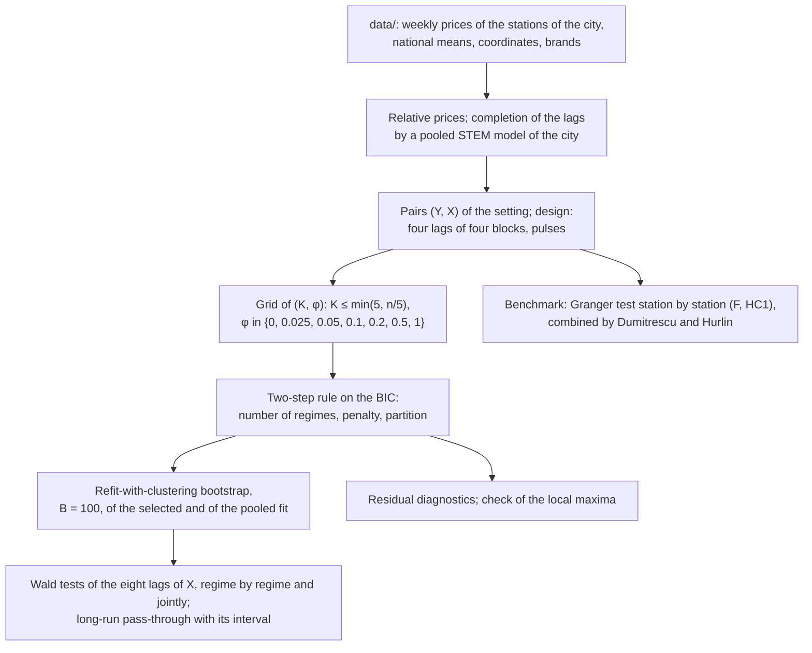
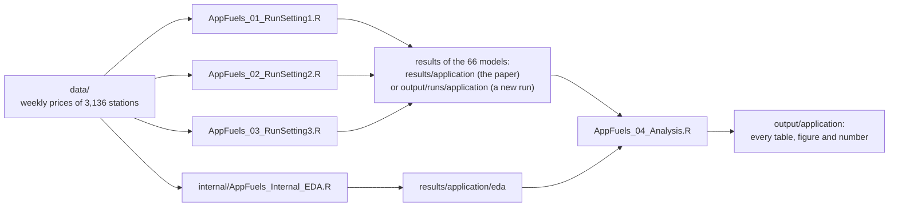
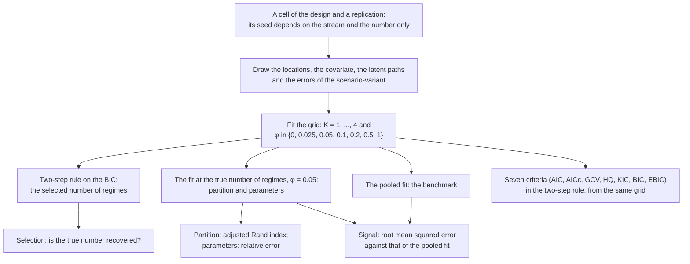
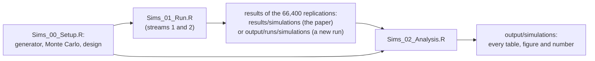

# Latent spatial regimes and local price leadership: paper, data and code

This folder holds the paper

> P. Maranzano, *Latent Spatial Regimes in Spatio-Temporal State-Space Models:
> Evidence on Local Price Leadership in Italian Fuel Markets*

with its supplementary material, the dataset of its application and the code
that reproduces its two empirical parts:

- [**Part I, the application**](#part-i-the-application): local price
  leadership among the fuel stations of eleven Italian cities (Section 5,
  Appendix C and Supplement C);
- [**Part II, the simulation study**](#part-ii-the-simulation-study): how the
  procedure behaves when the truth is known (Section 4, Appendix B and
  Supplement B).

The model, SC-STEM, partitions a network of locations, each observed over
time, into a few latent spatial regimes, each with its own regression
coefficients, latent dynamics and spatial covariance; it is implemented in the
R package **Stem** (<https://github.com/PaoloMaranzano/Stem>), whose
[documentation pages](../../docs/README.md) describe the estimation in detail.
The scripts here use Stem as an ordinary dependency; this folder is not part of
the package and is excluded from its builds.

Contents: [the folder](#the-folder) ·
[requirements and reproducibility](#requirements-and-reproducibility) ·
[Part I, the application](#part-i-the-application) ·
[Part II, the simulation study](#part-ii-the-simulation-study)

## The folder

```
papers/sc-stem-local-leader/
  README.md                       this file
  manuscript/                     the paper and its supplements (PDF)
    sc-stem-local-leader.pdf        the manuscript
    supplement-A-estimation.pdf     Supplement A: estimation and computation
    supplement-B-simulations.pdf    Supplement B: the simulation study
    supplement-C-application.pdf    Supplement C: the application
    code-supplement.pdf             the implementation in Stem
  data/                           the dataset of the application (Part I)
    fuel_stations.csv               the 3,136 stations of the eleven cities
    fuel_prices.csv.gz              their Sunday prices, January 2021 to June 2026
    fuel_national_means.csv         the national mean price of every Sunday
  code/
    AppFuels_00_Setup.R             Part I: the settings and the functions the
                                    other AppFuels scripts source
    AppFuels_01_RunSetting1.R       Part I: the 22 models of setting 1
    AppFuels_02_RunSetting2.R       Part I: the 22 models of setting 2
    AppFuels_03_RunSetting3.R       Part I: the 22 models of setting 3
    AppFuels_04_Analysis.R          Part I: every table, figure and number
    Sims_00_Setup.R                 Part II: the generator, the Monte Carlo,
                                    the runner and the design
    Sims_01_Run.R                   Part II: the run
    Sims_02_Analysis.R              Part II: every table, figure and number
  internal/
    AppFuels_Internal_EDA.R         Part I: the exploratory analysis of the data,
                                    which computed results/application/eda (not
                                    needed to reproduce the paper)
  results/                        the results of the runs of the paper (read by
                                  the analysis scripts)
    application/                    the compact results of the 66 models, and
                                    (eda/) the outputs of the exploratory analysis
    simulations/                    the results of the 66,400 replications
  output/                         what the scripts write (not versioned)
    application/                    the tables, figures and numbers of Part I
    simulations/                    the tables, figures and numbers of Part II
    runs/                           the results of a new run of the models or of
                                    the simulations, with their caches
```

`results/` and `output/` differ in who made them. `results/` holds what the
long runs of the paper produced (some 150 hours for the 66 models, 2,170
core-hours for the simulations), shipped so that the analysis scripts rebuild
every table and figure in minutes. `output/` is empty in the repository and
fills up as the scripts run: the tables and figures of the two analysis
scripts, and, only if the models or the simulations are run again, their new
results in `output/runs/`, which the analysis scripts read with `--results=`.

Every script opens with the title of the paper, its author, what the script
does and the outputs it writes; in the analysis scripts every section names
the table or figure of the paper it produces.

## Requirements and reproducibility

- R 4.2 or later, with the packages `data.table` and `geodist` from CRAN (and
  `remotes`, to install Stem).
- For the application, Stem at commit `09e9cdb` of its GitHub repository, the
  version the results were computed with. The run scripts check the installed
  version and, when it differs, install this one with
  `remotes::install_github("PaoloMaranzano/Stem@09e9cdb2d13fdfc94d8bc74e62645ebbc0b16a54")`.
  Restart R before running a script in a session where another version of Stem
  is loaded. `AppFuels_04_Analysis.R` does not need Stem; the exploratory
  analysis also needs `urca`.
- For the simulations, Stem at commit `0f7b744`
  (`remotes::install_github("PaoloMaranzano/Stem@0f7b74479b03a7fe5508eafe68fc7510c21422ad")`),
  and the packages `spdep` and `callr`.

Every script runs from a terminal (`Rscript <script>`, in `code/`) or from
RStudio (open it and press *Source*). Options are given on the command line as
`--name=value`; the header of every script lists them.

The scripts use Stem as an ordinary dependency: they check that the installed
version is the one the results were computed with, and install it otherwise.
Every routine that uses randomness takes an explicit seed and restores the
state of the random number generator on exit: the seed of a model of the
application depends only on its city and fuel, the seed of a replication of
the simulation study only on its stream and number, and the seed of a
bootstrap draw only on the seed of the bootstrap and on the draw. The results
therefore do not depend on the number of cores, on the order in which models
or replications are run, or on the machine; they reproduce exactly for the
simulation study and up to the numerical precision of the platform for the
application.

The scripts were checked on R 4.5.1 and R 4.6.1 (Windows): the two analysis
scripts, a model of the application run from the weekly data (completion of
the missing weeks included) and a replication of the simulation study give the
same tables, numbers and results on both, and the shipped results to within
$10^{-11}$. The figures differ between the two versions of R only in where the
text is placed, by a few pixels, since the two versions render fonts slightly
differently.

---

## Part I, the application

### The question

In a city, does the price of a fuel station follow that of its nearest
competitor? The application asks it as a question of prediction, in the sense
of Granger: do the past prices of the nearest competitor $X$ help to predict
the price of a station $Y$, given the past of $Y$? Three research questions
are addressed in each of the eleven cities:

1. **Local leadership.** Do the past prices of $X$ help to predict those of
   $Y$, and how much of a lasting change of the price of $X$ reaches $Y$?
2. **Heterogeneity.** Is the answer the same for all the stations of a city,
   as a model without regimes would assume? If not, what are the groups that
   answer differently: districts of the city, or brands and their pricing
   strategies?
3. **Fiscal pass-through.** Do the stations of a city pass the changes of the
   excise duties on to consumers at the same speed?

SC-STEM answers the three together: the stations of a city are partitioned
into regimes estimated from the prices, each regime has its own relation with
the neighbor, its own response to the excise duties, its own latent dynamics
and its own spatial covariance, and the test of leadership is run regime by
regime.

### The data

The prices come from Osservaprezzi Carburanti, the platform on which every
Italian fuel station posts its prices, published by the Italian Ministry of
Enterprises and Made in Italy as open data
(<https://www.mimit.gov.it/it/open-data/elenco-dataset/carburanti-prezzi-praticati-e-anagrafica-degli-impianti>,
license IODL 2.0). The daily file of the platform was pre-treated so as to keep
the stations that set their prices actively and report them regularly: codes
of the same site linked, highway stations excluded, at least 95% of the days
reported, no price left unchanged for more than 90 days. That leaves 12,246
stations in Italy, of which the application keeps those of the eleven largest
metropolitan cities with a known brand and coordinates: **3,136 stations**, 264
of them independent (*pompe bianche*), from 653 in Rome to 118 in Messina. Each
week is represented by its Sunday price, from January 2022 to June 2026
(**234 weeks**), and 2021 is a presample that provides the lags of the first
weeks. The weekly dataset in `data/` is the dataset of the paper.

`fuel_stations.csv`: one row per station, in the order the models use.

| column | content |
|---|---|
| `city` | code of the metropolitan city: RM Rome, MI Milan, NA Naples, TO Turin, PA Palermo, BA Bari, CT Catania, BO Bologna, ME Messina, FI Florence, VE Venice |
| `site` | identifier of the station |
| `municipality`, `province`, `area` | its municipality, province and geographic area (North, Center, South and islands) |
| `brand` | its brand at the end of the window; independent stations have brand "Pompe Bianche" |
| `group` | the brand for the five major brands (Agip Eni, Api-Ip, Esso, Q8, Tamoil), "independent", or "other brands" |
| `type` | the type of station: "Stradale" (street station) for all, highway stations being excluded |
| `lat`, `lon` | its coordinates (degrees, WGS84) |

`fuel_prices.csv.gz`: one row per station and Sunday, from 10 January 2021 to
28 June 2026 (286 Sundays); columns `city`, `site`, `week` (the date of the
Sunday), `gasoline` and `diesel` (self-service prices, euro per liter; empty
when the station did not report that day).

`fuel_national_means.csv`: one row per Sunday; `gasoline` and `diesel`, the mean
price over all the reporting non-highway stations of Italy (some 20,000), and
`stations`, how many reported gasoline.

The empty field marks a missing value. Read the files with
`data.table::fread(..., na.strings = "")` or `read.csv(..., na.strings = "")`:
the code of Naples is the string `NA`.

### From the prices to the data of the models

**Relative prices.** The response of a station is its relative price, in cents
per liter: the Sunday price net of the national mean of the week, which
removes the stochastic trend of costs and taxes common to all the stations of
Italy (the war in Ukraine in 2022, the closure of the Strait of Hormuz in
2026), and net of the mean of the station over the window, which removes its
permanent premium. With $p_{it}$ the Sunday price of a fuel at station $i$ in
week $t$, $\bar p_t$ the national mean and $\mathcal{T}_i$ the $T_i$ weeks in
which the station reports,

```math
z_{it} = (p_{it} - \bar p_t) - \frac{1}{T_i}\sum_{s \in \mathcal{T}_i}(p_{is} - \bar p_s).
```

The relative prices revert to their mean: the augmented Dickey-Fuller test
rejects a unit root for 96 to 100% of the stations of every city (Figure C1 of
Appendix C shows the two steps on two stations of Rome).

**Completion of the lags.** The response of a model keeps its missing weeks,
which the Kalman filter handles exactly; the covariates cannot have gaps, and
the lagged prices are covariates. The missing weeks of the series that enter
the lags (1.4 to 2.1% of the station-weeks) are therefore completed once, before
any model is fitted, by a pooled STEM model of each city and fuel, with an
intercept and the pulses of the excise duties: the completed value is the
conditional mean of the missing price given all the observed ones.

**Settings.** The neighbor $X$ of a station $Y$ is its nearest station of a
given group, which defines three settings:

| setting | stations Y | neighbor X | stations Y | median distance to X |
|---|---|---|---|---|
| 1 | a station of a major brand (Eni, Api-Ip, Esso, Q8, Tamoil) | the nearest independent station | 2,427 | 1.4 km in Naples, 2.8 to 7.9 km elsewhere |
| 2 | an independent station | the nearest station of a major brand | 264 (6 in Florence to 71 in Naples) | |
| 3 | a station of a major brand | the nearest station of another major brand | 2,427 | 0.6 to 1.6 km |

Every setting, city and fuel of $Y$ is a separate model: **3 × 11 × 2 = 66
models**.

**The pulses of the excise duties.** Five changes of the excise duties fall in
the window: the cut of 22 March 2022, its reduction on 1 December 2022, its end
on 1 January 2023, the realignment of 15 May 2025 and the equalization of
gasoline and diesel on 1 January 2026. Each gives two pulses, in the week of
the change and in the next.

### The model

**The choice of the lags.** The partial autocorrelation of the relative price,
station by station, exceeds the band $\pm 2/\sqrt{T}$ for all the stations at
lag 1, for 56 to 72% at lag 2, 26 to 41% at lag 3 and 14 to 22% at lag 4, and
for at most 17% from lag 5 on; the autoregressive order chosen by the AIC has
median 3 to 4; at lag 52 the partial autocorrelation is within the band for 99
to 100% of the stations, so there is no annual season. Every block of
regressors therefore takes four lags.

**The observation equation.** For a station $i$ of regime $k$ and week $t$, with
$z_{it}$ the relative price of the fuel, $o_{it}$ that of the other fuel at the
same station, and $x_{it}$, $w_{it}$ those of the two fuels at its neighbor,

```math
z_{it} = \beta_{0k} + \sum_{l=1}^{4}\bigl(b_{kl}z_{i,t-l} + c_{kl}o_{i,t-l} + d_{kl}x_{i,t-l} + e_{kl}w_{i,t-l}\bigr) + \gamma_k'\pi_t + y^{(k)}_t + \epsilon_{it},
```

with $\pi_t$ the pulses, $y^{(k)}_t$ the latent AR(1) process of the regime,
which absorbs the shocks common to its stations, and $\epsilon_{it}$ the
measurement error of the regime, a nugget plus a spatially correlated
component with exponential correlation. Every coefficient, the latent dynamics
and the spatial covariance are specific to the regime.

**Granger causality, regime by regime.** The neighbor leads the stations of
regime $k$ when its eight coefficients $(d_{kl}, e_{kl})_{l=1}^{4}$ are not all
zero. The hypothesis is tested by a Wald test whose covariance comes from the
refit-with-clustering bootstrap (below), so that the test carries the
uncertainty of the estimated partition; the test in all the regimes of a model
at once stacks the restrictions of every regime. The same test is run on the
pooled STEM model, which is what a model without regimes would conclude.

**The long-run pass-through.** The test says whether the neighbor leads, not by
how much. If the relative prices of a station and of its neighbor settled at
constant levels, the equation would give

```math
\lambda_k = \frac{\sum_{l=1}^4 d_{kl}}{1 - \sum_{l=1}^4 b_{kl}},
```

the change, in cents, of the relative price of a station of regime $k$ when
that of its neighbor on the same fuel moves permanently by one cent: one means
full alignment, zero that the station ignores its neighbor. Its interval is the
percentile interval of the bootstrap draws.

### How every model is estimated



1. **The regimes.** For every city, SC-STEM is fitted on the grid of $(K, \phi)$,
   with $K \le \min(5, \lfloor n/5 \rfloor)$ for $n$ stations $Y$, so that every
   regime has at least five stations, and the default grid of the Potts
   penalty $\phi$, on the 5-nearest-neighbor graph of the stations. The
   two-step rule on the BIC selects the number of regimes and the penalty, and
   with them the partition. Below ten stations the model is the pooled STEM
   model. Every fit runs the alternation of SC-STEM (Algorithm 1 of the paper)
   with the SQUAREM-accelerated EM algorithm.
2. **Inference.** The refit-with-clustering bootstrap of the selected fit, with
   $B = 100$ draws, simulates new prices from the fitted model regime by regime
   and re-estimates the whole procedure, partition included, on every draw; the
   aligned draws give the Wald statistics, the intervals of the coefficients and
   of $\lambda_k$, and the stability of the partition. The pooled STEM model is
   fitted, bootstrapped and tested in the same way.
3. **Benchmark.** The Granger test is also run station by station by least
   squares, in its classical $F$ form and with the heteroskedasticity-consistent
   covariance HC1, and combined over the stations of a city by the test of
   Dumitrescu and Hurlin.
4. **Checks.** The residual diagnostics of every regime (normality, kurtosis,
   heteroskedasticity, autocorrelation), and a check that the selected fit is
   not a local maximum: the selected partition is refitted regime by regime
   from another start, and the two maxima are compared.

### Running it

**Quick path: the tables and figures from the shipped results.**

```
cd papers/sc-stem-local-leader/code
Rscript AppFuels_04_Analysis.R
```

It reads `results/application` and writes the tables, the figures and the
numbers of the paper into `output/application` in about a minute.

**Full path.**

```
cd papers/sc-stem-local-leader/code
Rscript AppFuels_01_RunSetting1.R --cores=7
Rscript AppFuels_02_RunSetting2.R --cores=7
Rscript AppFuels_03_RunSetting3.R --cores=7
Rscript AppFuels_04_Analysis.R --results=../output/runs/application
```

Each run script builds the data of its setting from `data/` (the completion
takes about an hour on a first run, most of it for Rome; it is cached and the
three settings share it) and fits its 22 models. This is the long step: in the
run of the paper, settings 1 and 3 took about 73 hours each with the
bootstraps on seven cores (Rome alone about a day), and setting 2 about 5
hours; the largest models (Rome, Milan, Turin in settings 1 and 3) need some GB
of memory. Every model is saved as soon as it is done and a stopped run
resumes; a subset of the models can be run with `--cities=` and `--fuels=`, and
the three settings can run on different machines. Each run reproduces the
shipped results up to the numerical precision of the platform.



### Where every result of the paper comes from

All the outputs below are written by `AppFuels_04_Analysis.R` into
`output/application`; the section of the script that writes each is given in
its header.

| output | place in the paper |
|---|---|
| `tab_app_main.tex` | Section 5.3, Table 1 |
| `fig_app_leadership.png` | Section 5.3, Figure 3 |
| `fig_app_maps.png` | Section 5.3, Figure 4 |
| `fig_app_passthrough.png` | Section 5.3, Figure 5 |
| `tab_app_models.tex` | Supplement C, Section C3, Table C1 |
| `fig_app_map_s1_RM_gasoline.png`, `fig_app_map_s3_NA_gasoline.png` | Supplement C, Section C4, Figure C1 |
| `tab_app_regimes_s1.tex`, `_s2.tex`, `_s3.tex` | Supplement C, Section C4, Tables C2 to C4 |
| `tab_app_joint.tex` | Supplement C, Section C4, Table C5 |
| `tab_app_distance.tex` | Supplement C, Section C5, Table C6 |
| `tab_app_pulses.tex` | Supplement C, Section C7, Table C7 |
| `app_numbers.csv` | every other number quoted in Sections 5.3 and 5.4 and in Sections C3 to C8 of Supplement C, one row each, with its place |
| `eda/eda_stations_by_city.csv` | Section 5.1; Supplement C, Section C1 (table of the stations) |
| `eda/eda_window.csv`, `eda/eda_missing_weeks.csv` | Section 5.1; Supplement C, Sections C1 and C2 |
| `eda/eda_unit_roots_and_stickiness.csv` | Section 5.1 (ADF test); Supplement C, Section C1 (ADF, autocorrelation, unchanged prices) |
| `eda/eda_pairs.csv` | Section 5.1; Supplement C, Section C1 (stations Y, distances to X) |
| `eda/eda_pacf_share_outside_band.csv`, `eda/eda_ar_order.csv` | Section 5.2; Supplement C, Section C2 (the choice of the lags) |
| `eda/fig_app_centring.png`, `eda/fig_app_centring_stations.csv` | Appendix C, Figure C1 and its text |

The `eda/` outputs describe the weekly data before any model is fitted. They
were computed by the exploratory analysis of the data,
`internal/AppFuels_Internal_EDA.R` (see `internal/README.md`); they are stored
in `results/application/eda` and `AppFuels_04_Analysis.R` copies them among
its outputs.

### The compact results

`results/application/setting<s>/<city>_<fuel>/` holds, for each of the 66
models, what the run scripts write: `model.csv` (the selected number of
regimes and penalty, the sizes of the regimes, the usable bootstrap draws, the
stability of the partition, the minutes taken), `grid.csv` (the information
criteria over the grid), `regimes.csv` (the stations Y, their station X and
their regime), `estimates.csv` (the estimates of the selected and of the
pooled fit, with bootstrap standard errors and intervals), `draws.csv.gz` (the
aligned bootstrap draws of the regression coefficients of the selected fit),
`wald.csv` (the bootstrap Wald tests), `pump_tests.csv` and
`dumitrescu_hurlin.csv` (the station-by-station benchmark),
`diagnostics.csv` (the residual diagnostics) and `optima.csv`,
`optima_coefficients.csv` (the check of the local maxima).
`results/application/setting<s>/models.csv` stacks the rows of `model.csv`.

---

## Part II, the simulation study

### The questions

The simulations ask whether SC-STEM does what it is designed for, when the
truth is known:

1. **Complete heterogeneity.** When every block of parameters differs across
   the regimes, does the procedure recover the number of regimes, the partition
   and the parameters of every regime?
2. **Complete homogeneity.** When the data come from the pooled STEM model, how
   often does it declare regimes that do not exist?
3. **One common block.** When one block of parameters is common to the regimes
   and the others differ, how much does the recovery change: how much does
   each block contribute to telling the regimes apart?

Every replication runs the whole procedure a user would run, from the grid of
$(K, \phi)$ to the selected fit.

### The data-generating process

One generator produces every scenario. There are $K_0 = 3$ regimes (one in the
pooled scenario), one latent process loading equally on every location
($p = 1$, $A = \mathbf{1}_d$) and one covariate. For a location $i$ of regime $k$,

```math
z_{it} = \beta_{0k} + \beta_{1k} x_{it} + y^{(k)}_t + e_{it}, \qquad
y^{(k)}_t = G_k y^{(k)}_{t-1} + \eta^{(k)}_t, \qquad
e_{t,\mathcal{C}_k} \sim N\bigl(0,\ \sigma^2_{\epsilon k} I + \sigma^2_{\omega k} C_{\theta_k}\bigr),
```

with $[C_\theta]_{ij} = e^{-\theta h_{ij}}$ and $\theta_k = 3/R_k$, $R_k$ the
practical range (the distance at which the spatial correlation falls to 5%).

- **The covariate** is an AR(1) in time, $x_t = 0.7\,x_{t-1} + \sqrt{1 - 0.7^2}\,u_t$,
  whose innovations $u_t$ are a spatial field with practical range 4, the
  extent of the network, then standardized.
- **The latent processes** are AR(1), one per regime, with innovations
  $\eta^{(k)}_t = \sigma_{\eta k}(\sqrt{\rho}\,\xi_t + \sqrt{1-\rho}\,\zeta_{kt})$:
  $\xi_t$ is a shock common to the regimes and $\zeta_{kt}$ one specific to
  regime $k$, so that $\rho$ is the correlation of the innovations of two
  regimes. They start from zero and run a burn-in of 200 periods.
- **The measurement error** is drawn regime by regime, or, where the range is
  common to the regimes, as one spatial field over the whole network scaled
  regime by regime.
- **The locations** of a regime are drawn around its center, the centers at
  the vertices of an equilateral triangle of side $2\omega$, in four
  geometries: total overlap ($\omega = 0$, the regimes occupy the same area);
  medium-high overlap ($\omega = 0.7$, contiguous regimes interpenetrating
  along their borders, the reference); medium-low overlap ($\omega = 1$, the
  regimes keeping their spread, the network widening); strong separation
  ($\omega = 1$, compact regimes in a network of fixed extent). The regime
  sizes are equal, or in the proportions 1:2:3.

The baseline regime (regime 1 of every scenario, and the only regime of the
pooled one) has $\beta_0 = 2$, $\beta_1 = 0.55$, $G = 0.8$, stationary latent
variance $v = 0.30$, $\sigma^2_\epsilon = \sigma^2_\omega = 0.20$ and $R = 2$:
the response has variance about one, so every contrast between regimes reads
in standard deviations of the response.

### Scenarios and variants

A scenario fixes the parameter values of the three regimes (regimes 1 / 2 / 3;
$v$ is the stationary variance of the latent process,
$\sigma^2_\eta = v(1 - G^2)$):

| scenario | what it is | $\beta_0$ | $\beta_1$ | $G$ | $v$ | $\sigma^2_\epsilon$ | $\sigma^2_\omega$ | $R$ |
|---|---|---|---|---|---|---|---|---|
| S2 | no regimes: the pooled STEM model | 2 | 0.55 | 0.8 | 0.30 | 0.20 | 0.20 | 2 |
| S1s | every block differs, strongly | 2 / 2.3 / 2.6 | 0.55 / 0.85 / 1.15 | 0.8 / 0.5 / 0.2 | 0.30 / 0.40 / 0.50 | 0.20 / 0.35 / 0.40 | 0.20 / 0.15 / 0.20 | 2 / 1.5 / 1 |
| S1w | every block differs, weakly | 2 / 2.1 / 2.2 | 0.55 / 0.65 / 0.75 | 0.8 / 0.7 / 0.6 | 0.30 / 0.35 / 0.40 | 0.20 / 0.25 / 0.30 | 0.20 / 0.175 / 0.15 | 2 / 1.5 / 1 |
| S3beta | as S1s, common coefficients | 2 | 0.55 | as S1s | as S1s | as S1s | as S1s | as S1s |
| S3G | as S1s, common persistence | as S1s | as S1s | 0.8 | as S1s | as S1s | as S1s | as S1s |
| S3Seta | as S1s, common $\sigma^2_\eta = 0.108$ | as S1s | as S1s | as S1s | 0.30 / 0.14 / 0.11 | as S1s | as S1s | as S1s |
| S3theta | as S1s, common range | as S1s | as S1s | as S1s | as S1s | as S1s | as S1s | 2 |
| S3error | as S1s, common error | as S1s | as S1s | as S1s | as S1s | 0.20 | 0.20 | 2 |

A variant fixes how the regimes are linked to one another:

- **`ind`**: independent latent processes ($\rho = 0$) and error fields by
  regime: exactly the SC-STEM model;
- **`shr`**: the regimes share the latent shocks ($\rho = 1$), which each
  filters with its own parameters, and, where the range is common, one spatial
  field, so that the regimes differ through their parameters only; it is a
  realistic departure from the model (the stations of different regimes, for
  instance, face the same cost shocks).

The study runs nine scenario-variants: S2; S1s-`ind` and S1s-`shr`; S1w-`shr`;
S3beta-, S3G-, S3Seta-, S3theta- and S3error-`shr`. How hard each is follows
from the values above and is measured, after the fact, by the expected
log-likelihood ratio that a location accumulates in favor of its own regime
over 120 periods (Section B4 of Supplement B), in nats: 107 for S1s-`ind`;
about 25 for S1s-`shr` and S3theta-`shr`; 19.5 and 20.6 for S3G- and
S3Seta-`shr`; 35.5 for S3error-`shr`; and only 6.6 for S3beta-`shr` and 4.5 for
S1w-`shr`, the two hard cases of the design. The values of the parameters
induce the separation; the measure quantifies it.

### The design

The nine scenario-variants are crossed with five margins: the number of
locations $d \in \{40, 100, 200, 400\}$, the length of the series
$T \in \{60, 120, 365\}$, the four geometries, balanced or unbalanced regime
sizes, and the number of neighbors $m \in \{3, 5, 10\}$ of the graph of the
Potts penalty. The reference cell is $d = 100$, $T = 120$, medium-high overlap,
balanced sizes and $m = 5$. The design is the union of five blocks around it:
the **core** crosses $d \in \{40, 100, 200\}$, $T$ and three geometries (225
cells); **spread** adds the fourth geometry (72); **balance** (8), **knn** (18)
and **n400** (9) vary one margin at the reference cell. **332 cells, 200
replications each**, run as two streams of 100 on two machines.

### The procedure on every replication, and what is measured



Every replication fits the grid of $K = 1, \dots, 4$ regimes and of the
penalties $\phi \in \{0, 0.025, 0.05, 0.1, 0.2, 0.5, 1\}$, every penalized fit
starting from the unpenalized fit at the same $K$, and applies the two-step
selection rule on the BIC with its default band $[0.025, 0.2]$. Every fit runs
the alternation of SC-STEM with the EM algorithm: accelerated by SQUAREM, with
tolerances of $10^{-3}$ on the relative change of the parameters and on the
change of the log-likelihood, in the pooled fit and in the final refits; plain,
with tolerances of $10^{-2}$ and $1$ and at most 50 iterations, inside the
alternation, where it only has to rank the regimes. What is measured:

- **the selection**: the share of the replications that select the true number
  of regimes (one in S2, where any other choice is a false positive), and the
  direction of the errors;
- **the partition**, read off the fit at the true number of regimes and
  $\phi = 0.05$, so that a poor estimate is not confounded with a poor
  selection: the adjusted Rand index with the true partition;
- **the parameters** of the same fit, with the estimated regimes aligned on the
  true ones: the relative error, (estimate - truth) / |truth|;
- **the signal**: the root mean squared error of the fitted conditional mean
  against the true one, as a ratio to that of the pooled fit;
- **the criteria**: the selection redone with seven information criteria on
  the same grid.

Every replication runs in a separate R process under a time limit adapted to
its cell; a replication over the limit is drawn again with the seed of its next
attempt.

### Running it

The study ran on Stem at commit `0f7b744`, which `Sims_01_Run.R` installs when
another version is installed:

```
cd papers/sc-stem-local-leader/code
Rscript Sims_00_Setup.R                               # prints the design
Rscript Sims_01_Run.R --stream=1 --nrep=100 --cores=7 # machine 1
Rscript Sims_01_Run.R --stream=2 --nrep=100 --cores=7 # machine 2
Rscript Sims_02_Analysis.R --results=../output/runs/simulations
```



The seed of a replication depends only on its stream and number, so the
results do not depend on the cores or on the machine; a stopped run resumes
where it stopped. The 66,400 replications took about 2,170 core-hours, about a
week on two desktop computers.

`Sims_02_Analysis.R` without options reads `results/simulations` and writes
into `output/simulations` in about an hour and a half on a desktop computer,
most of it for re-applying the selection rule with seven criteria to every
replication (part R9 of the script); its header lists every output with its
place in the paper and the part of the script that writes it.

### The stored results

`results/simulations` holds the results of the two streams, compressed:
`main3_s<stream>.csv.gz` (one row per replication: the selected number of
regimes and penalty, the recovery of the partition, the error of the fitted
signal, the times), `main3_s<stream>-params.csv.gz` (one row per replication,
regime and parameter: the truth and the estimate at the true number of
regimes) and `main3_s<stream>-grid.csv.gz` (one row per replication and
configuration of the grid). The per-location records and the full
observations that `Sims_01_Run.R` also writes are left out: the analysis does
not use them, and any replication can be drawn again from its seed. A few
lines broken by the synchronization client while the runs appended to the
files were dropped, and 17 replications failed for reasons unrelated to the
estimator (Section B6 of Supplement B).
